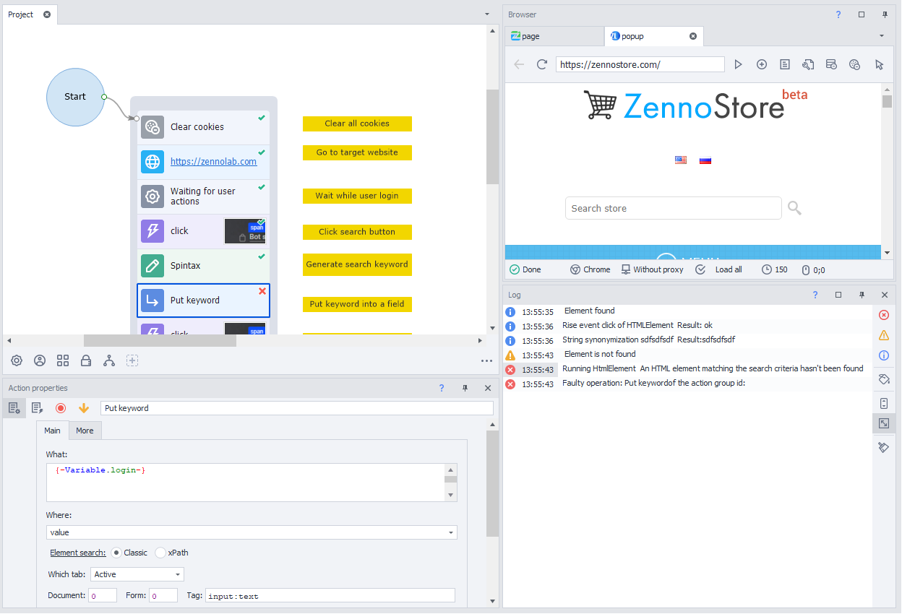
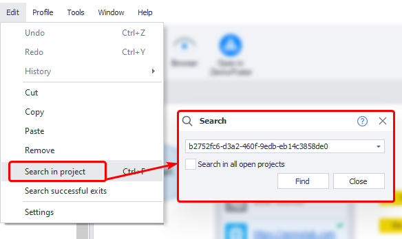

---
sidebar_position: 3
title: "Debugging Errors"
description: ""
date: "2025-08-18"
converted: true
originalFile: "Ошибки при отладке.txt"
targetUrl: "https://zennolab.atlassian.net/wiki/spaces/RU/pages/494895107"
---
import DisclaimerNotice from '@site/src/components/DisclaimerNotice';

<DisclaimerNotice />

> 🔗 **[Original page](https://zennolab.atlassian.net/wiki/spaces/RU/pages/494895107)** — Source of this material

_______________________________________________  
## Description
During template development and testing, use the [log window](https://zennolab.atlassian.net/wiki/spaces/RU/pages/725352532 "https://zennolab.atlassian.net/wiki/spaces/RU/pages/725352532") to find and fix errors. It records the results of all successful and failed actions.

### Tools for working with errors:
- **Color coding.** Entries for failed actions are highlighted in red.  
- **Quick navigation.** Double-click a log entry to automatically locate the problematic action and center the project workspace on it.  
- **Copying IDs.** Right-click an entry to copy the action's ID. This option is also available in the ZennoPoster log.

### Search
You can easily [find a specific action by its ID](https://zennolab.atlassian.net/wiki/spaces/RU/pages/724566074 "https://zennolab.atlassian.net/wiki/spaces/RU/pages/724566074"):  

Once you have found the action that caused the error, you can [adjust its parameters](https://zennolab.atlassian.net/wiki/spaces/RU/pages/494731280 "https://zennolab.atlassian.net/wiki/spaces/RU/pages/494731280") and [resume project execution from the current action](https://zennolab.atlassian.net/wiki/spaces/RU/pages/494731265/1#%D0%A1-%D0%BA%D1%83%D1%80%D1%81%D0%BE%D1%80%D0%B0 "https://zennolab.atlassian.net/wiki/spaces/RU/pages/494731265/1#%D0%A1-%D0%BA%D1%83%D1%80%D1%81%D0%BE%D1%80%D0%B0").  

_______________________________________________ 