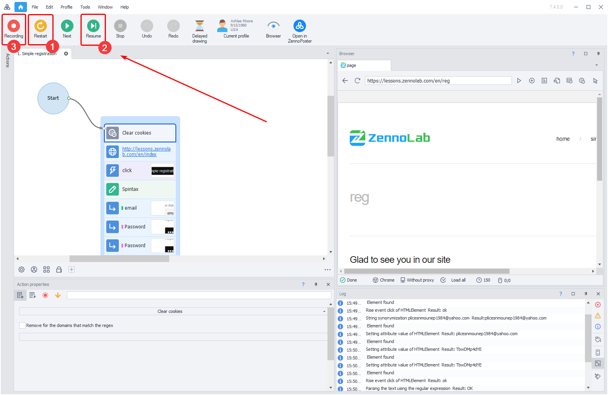

---
sidebar_position: 4
title: "Updating Problematic Actions"
description: ""
date: "2025-08-18"
converted: true
originalFile: "Дозапись проблемных участков.txt"
targetUrl: "https://zennolab.atlassian.net/wiki/spaces/RU/pages/494731287"
---
import DisclaimerNotice from '@site/src/components/DisclaimerNotice';

<DisclaimerNotice />

> 🔗 **[Original page](https://zennolab.atlassian.net/wiki/spaces/RU/pages/494731287)** — Source of this material

_______________________________________________  
## Description
If the target site changes the structure or code of its pages, existing actions may stop working (for example, an element's attributes may change, or the element may disappear altogether).  

In such cases, you can re-record outdated actions while keeping the main project structure intact.

### How to update actions:  
1. Open the template and start debugging with **From the Beginning (1)** or **To the End (2)**. Execution stops at the first breakpoint or at a step that fails.  
2. When you reach the problematic section, enable **Record (3)** mode.  
3. Perform the required actions in the browser in real time to record new, up-to-date actions to replace the ones that no longer work.  

