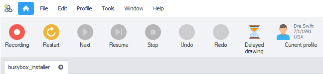
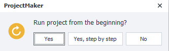
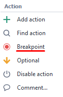
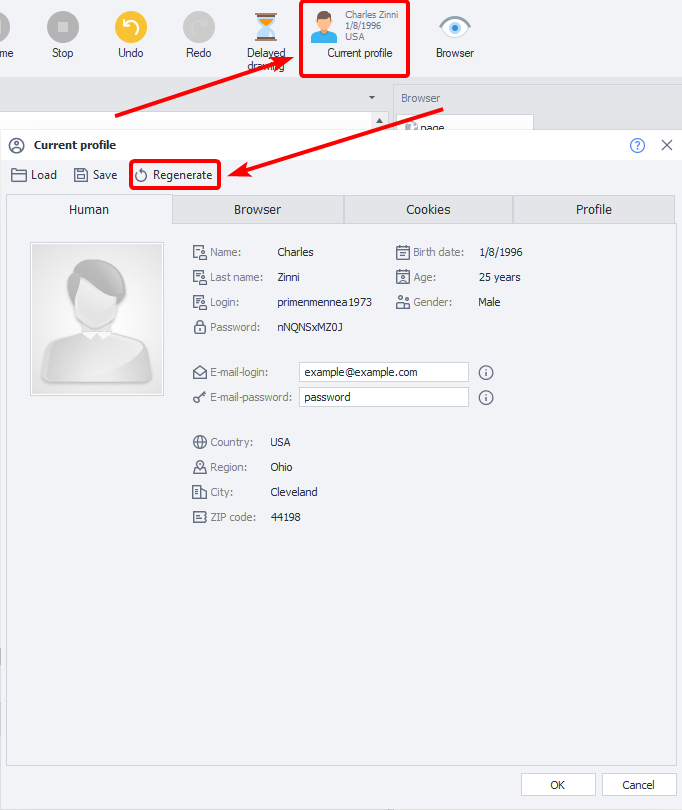

---
sidebar_position: 1
title: "Starting Debugging"
description: ""
date: "2025-08-18"
converted: true
originalFile: "Запуск отладки.txt"
targetUrl: "https://zennolab.atlassian.net/wiki/spaces/RU/pages/494731265"
---
import DisclaimerNotice from '@site/src/components/DisclaimerNotice';

<DisclaimerNotice />

> 🔗 **[Original page](https://zennolab.atlassian.net/wiki/spaces/RU/pages/494731265)** — Source of this material

_______________________________________________  
## Starting Debugging
  

Let's take a closer look at the recording and debugging panel. 

### From the Beginning
Click this button to run the project from the very beginning. A new profile is generated.  

### Step by Step
When you start **From the Beginning**, you are offered the option to run the entire project **Step by Step**. In this mode, each subsequent action runs only after you click **Next**.  

 

If you click **Yes** instead of **Yes, step by step**, the project runs directly to the end or to the next **breakpoint**. You can set a breakpoint by right-clicking any action.  

   

You can switch between these two modes during debugging by using **Next** (step by step) and **To the End** (until a breakpoint).

### From the Cursor {#from-the-cursor}
Click any action in the project, then click one of the start buttons to begin execution from that point.

This feature is invaluable when troubleshooting: you can adjust individual action settings and immediately test the changes without restarting the entire project.
## Profile Regeneration
While testing a template, you can regenerate the identity values by clicking the dedicated button.  

For example, this lets you check how a site or application responds to specific values.

For more information about profiles, see [Profile Window](/zennoposter/ProjectMaker/Program-interface/Profile_Window).