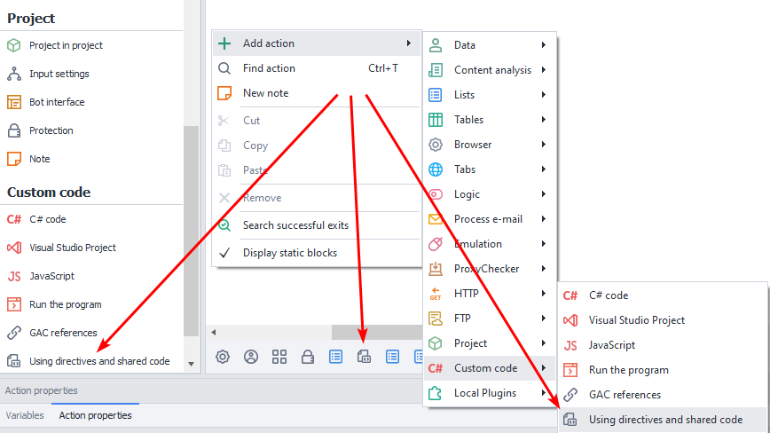
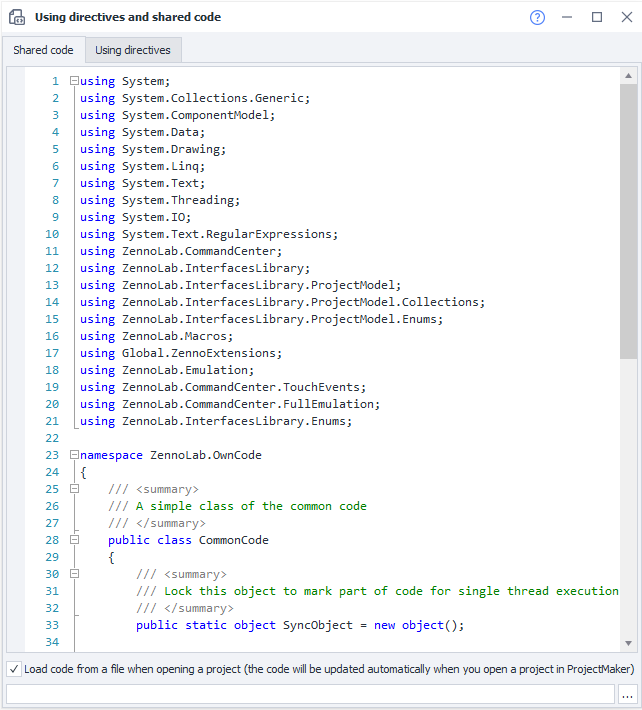
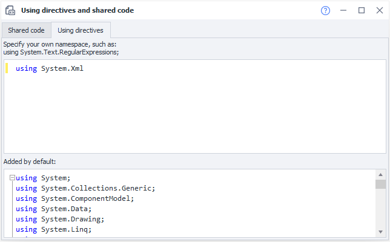
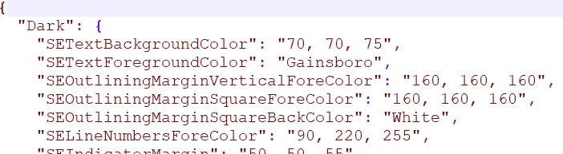

---
sidebar_position: 5
title: "Using Directives and Shared Code"
description: ""
date: "2025-08-04"
converted: true
originalFile: "Директивы using и общий код.txt"
targetUrl: "https://zennolab.atlassian.net/wiki/spaces/RU/pages/492109917/using"
---
import DisclaimerNotice from '@site/src/components/DisclaimerNotice';

<DisclaimerNotice />

> 🔗 **[Original page](https://zennolab.atlassian.net/wiki/spaces/RU/pages/492109917/using)** — Source of this material

_______________________________________________  
## Description
:::note Note
Starting with ZennoPoster version 7.3.2.0, you can connect Visual Studio. For detailed instructions, see the [Visual Studio Project](./Visual_Studio_Project.mdx) article.
:::

**Shared code** is a feature that extends the capabilities of standard C# actions. It’s used to add extra classes and functions.   

**Using directives** let you access functions and classes, as well as create namespaces.  

#### How can you use it?  
- Work more efficiently with C# code.  
- Create new namespaces.  
- Organize large amounts of code.  
- Avoid namespace conflicts.

:::warning **Working with shared code requires basic knowledge of C#.**
:::  

### How do you add an action to a project?
From the context menu: **Add action** → **Custom code** → **Using directives and shared code**

  

> *When you add an action in the [Static blocks panel](/zennoposter/ProjectMaker/Project-editor/Static_blocks/General_Principles_of_Operation), the corresponding block will appear.*  
_______________________________________________
## Shared Code
This window is a code editor with syntax highlighting. Its context menu gives you access to basic code editing features: copy, paste, commenting, search, replace, and so on.  

At the bottom of the window, there’s a checkbox that lets you load code from a `.txt` or `.cs` file.  



All **using** directives used in the project are listed first. Next, there’s an example of declaring `namespace ZennoLab.OwnCode`. You can create your own namespaces in the same way and use them later.  

To access functions and methods in shared code, declare them with the `public` modifier. If you don’t need to work with objects of a particular class, you can declare it as `public static`. And if inheritance won’t be needed, it’s best to declare the class as `public sealed` from the start.  

:::warning You can’t directly access `instance` or `project` entities from shared code
Unlike in C# actions.  

To work with an instance, initialize these objects using `new`:  
(`Instance instance = new Instance("127.0.0.1", 40500, "server");`)  
or pass them as function arguments.  

The same applies to project variables: pass their values as function arguments.
:::
_______________________________________________
## Using Directives  
  

When you switch to this tab, you’ll see two fields:  
- **Top**. Use this field to add *namespaces* that are used when running code in C# actions. For example, to parse XML, enter `using System.Xml;`.  
- **Bottom**. This field lists all the *using* directives used by the project by default. You can’t edit them.  
_______________________________________________
## Fine-tuning the code editor’s appearance

:::info Information
Added in ZennoPoster 7.2.1.0.
:::

:::warning Attention
These settings affect both «Using directives and shared code» and how code is displayed in the [C# code](./CSharp_Code.mdx) action.
:::

You can customize the code editor’s colors. The `SyntaxEditorColors.json` file is located in `%AppData%\ZennoLab\ZennoPoster\7\ProjectMaker`. Colors for the light and dark themes are configured separately, using RGB values or color names.



_______________________________________________
## Example.

### Passing an instance to shared code: HtmlClick

In this example, the `instance` object is passed to the `HtmlClick` function as an argument. The function searches for an HTML element by its attributes and clicks it. If the element is found, it returns the string `success`; otherwise, it returns `fail`.

```csharp
namespace ZennoLab.OwnCode
{
    public class CommonCode
    {
        public static string HtmlClick(Instance instance)
        {
            HtmlElement element = instance.ActiveTab.FindElementByAttribute("div", "class", "html", "regexp", 0);
            if (element.IsVoid)
            {
                return "fail";
            }

            element.Click();
            return "success";
        }
    }
}
```

To call the function from a [C# action](./CSharp_Code.mdx), use:

```csharp
return ZennoLab.OwnCode.CommonCode.HtmlClick(instance);
```

This is useful when there are multiple places in a project where you need to click the same element.

### Changing image opacity: SetImageOpacity

Pass an image and an opacity value to the `SetImageOpacity` method. It returns a semi-transparent image that you can save to disk.  
```C
public static Image SetImageOpacity(Image image, float opacity)  
{  
    try  {  
		Bitmap bmp = new Bitmap(image.Width, image.Height);
        //создание графики из картинки
        using (Graphics gfx = Graphics.FromImage(bmp)) {
            //создание объекта color matrix  
            ColorMatrix matrix = new ColorMatrix();      
            //установка прозрачности 
            matrix.Matrix33 = opacity;  
            //создание новых атрибутов
            ImageAttributes attributes = new ImageAttributes();      
            //установка цвета прозрачности картинки
            attributes.SetColorMatrix(matrix, ColorMatrixFlag.Default, ColorAdjustType.Bitmap);    
            //отрисовываем картинку
            gfx.DrawImage(image, new Rectangle(0, 0, bmp.Width, bmp.Height), 0, 0, image.Width, image.Height, GraphicsUnit.Pixel, attributes);
        }
        return bmp;  
    }  
    catch (Exception ex) {  
        return null;  
    }  
} 
```  

Here’s how to call this function from a [**C# action**](./CSharp_Code):  
`Image img = OwnCode.CommonCode.SetImageOpacity(Image.FromFile(project.Directory + "//image.jpg"), .5f);`
_______________________________________________

## Useful links

- [Visual Studio Project](./Visual_Studio_Project.mdx)
- [References from GAC](./References_from_GAC.mdx)
- [Using directive (C# reference)](https://learn.microsoft.com/ru-ru/dotnet/csharp/language-reference/keywords/using-directive)
- [C# code (C# .NET code)](./CSharp_Code.mdx)
