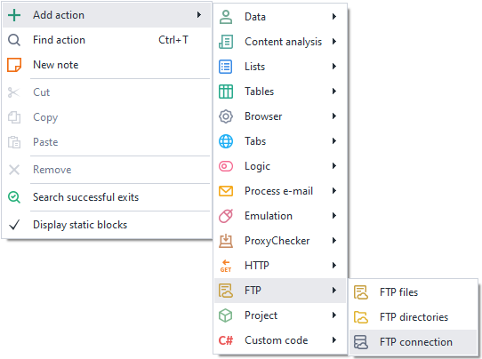
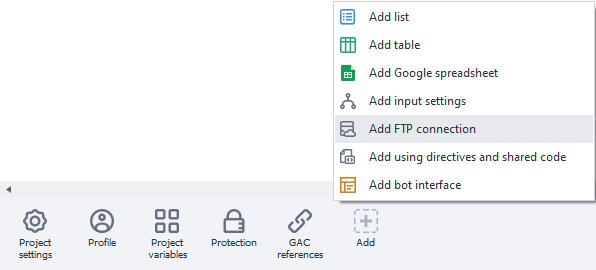
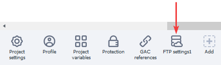
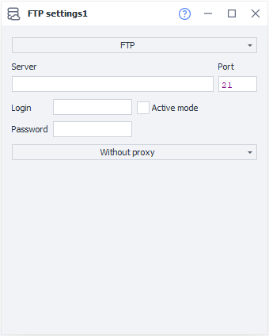

---
sidebar_position: 3
title: "FTP Connection"
description: ""
date: "2025-08-04"
converted: true
originalFile: "Соединение FTP.txt"
targetUrl: "https://zennolab.atlassian.net/wiki/spaces/RU/pages/534053064/FTP"
---
import DisclaimerNotice from '@site/src/components/DisclaimerNotice';

<DisclaimerNotice />

> 🔗 **[Original page](https://zennolab.atlassian.net/wiki/spaces/RU/pages/534053064/FTP)** — Source of this material

_______________________________________________  
## How to create it?  
You can create a new FTP connection from the context menu:  
**Add action → FTP → FTP connection** 

  

or through the ***Static blocks panel***:  

  
_______________________________________________
## How to use it?  
  

### Available settings.  
  

#### Select a transfer protocol type.  
Click the topmost field to open a list of available protocols:  
- **FTP (File Transfer Protocol).**  
A standard protocol designed for transferring files.  
- **FTPs (FTP + SSL).**  
A secure file transfer protocol.  
- **sFTP (SSH(Secure Shell) + FTP).**  
A protocol for file operations over a reliable and secure connection.  

#### Server (required).  
Enter the FTP server name here.  

#### Port (required).  
Enter the port for the FTP connection. The default is `21`.  

#### Login and password.  
Credentials for connecting. You can leave these blank if the server allows it.  

#### Active mode.  
Check this box if you need to use FTP active mode.  
:::info **Key feature of active mode**  
The *server initiates the connection* to transfer data.  
This can cause problems if you have a Firewall or NAT enabled that blocks incoming connections.
::: 

#### Proxy.  
You can leave the setting as *No proxy*, or choose one of the following:  
- *Current project proxy*;
- *A string in the format protocol://login:pass@ip:port*;  
- *Other*.  

In *Other* mode, you can enter a proxy in any format by filling in the required fields.  
The address, port, and authentication details are provided by your service provider.

## Useful links
- [FTP Files](./FTP_Files)
- [FTP Directories](./FTP_Directories)
