import DisclaimerNotice from '@site/src/components/DisclaimerNotice';

<DisclaimerNotice />

> 🔗 **[Original page](https://zennolab.atlassian.net/wiki/spaces/RU/pages/483426308)** — Source of this material

_______________________________________________  
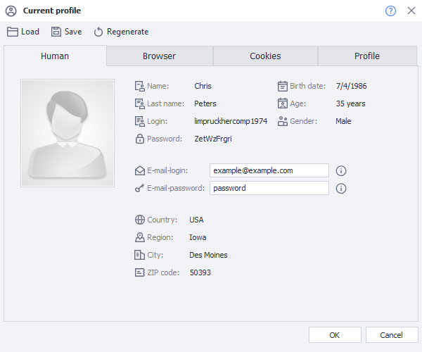  
_______________________________________________
A **profile** is a virtual identity whose parameters are generated each time a template is started. In ProjectMaker, generation takes place when you click **“Start”**; in ZennoDroid, it happens each time the project is run. Detailed profile information is provided in the **Profile window**.   

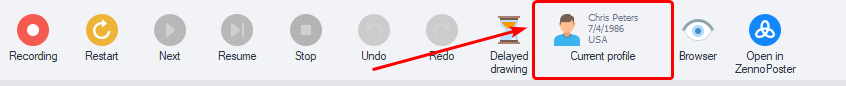   

When the project runs, all the necessary data is generated in the profile, such as:  
- personal data used during registration;    
- device data needed to work with services.  
:::warning **Important**
It’s best to avoid reassigning individual profile settings during a single project run — instead, simply finish the project and run it again as many times as needed. This keeps you from having to add complex internal loops to your project.
::: 

When registering accounts, the correct project workflow looks like this:  
**1.** Start the project.  
**2.** Generate one new profile.  
**3.** Perform the necessary actions.  
**4.** Finish the project. 
_______________________________________________
## Profile generation settings for the current project
To open the profile generation settings, click the **Profile** icon on the **Static Blocks Panel**. It’s located beneath the action canvas:  

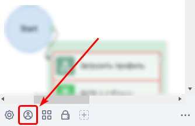

:::info **Can’t see the *Static Blocks Panel*?**
Right-click anywhere on an empty area of the action canvas and select the corresponding setting from the context menu to show this area.

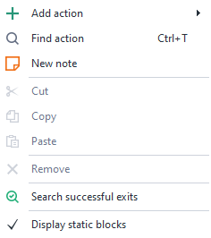 
:::    
_______________________________________________
## “User” tab 
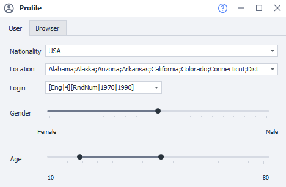

### Nationality
:::tip **Default nationality.**
*You can set this in Settings, on the Profile tab. You can also enter your email address and its password there.*
::: 

6 nationalities are available:  
- Russia,  
- USA,  
- Germany,  
- France,  
- Spain,  
- United Kingdom.

### Location
You can set the location using a drop-down list that lets you select multiple values. The list contents depend on the selected country:  
- Russia — regions, territories, republics, and some large cities (Moscow, Sochi, and others);  
- USA — states;  
- Germany — states;  
- France — regions;  
- Spain — autonomous communities;  
- United Kingdom — constituent countries.  

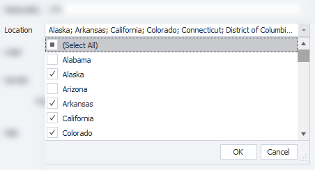

### Login
The login is generated using a formula made up of several parts. By default, several types of formulas are already saved in the settings. You can also enter your own.  

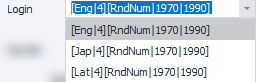
#### Detailed description of formulas  
Currently, formulas support these languages: `Eng` — English, `Lat` — Latin, `Jap` — Japanese.  
For example, entering `[Eng|4]` generates a nickname that’s 4 English syllables long, with syllable combinations weighted to occur as often as they do in real words. You can create more complex constructions by changing the formula. Let’s look at this formula:  

`[RndSym|[RndNum|0|4]|0123456789][Lat|3][RndSym|[RndNum|0|2]|-][Jap|1][RndText|2|D]`  

`[RndSym|[RndNum|0|4]|0123456789]` — means the nickname will start with 0 to 3 digits;  
`[Lat|3]` — generates 3 syllables in Latin;  
`[RndSym|[RndNum|0|2]|-]` — picks 2 random letters or digits.  

The generated nicknames will look like this:  
- 053bomenca-iem,  
- 7lialeme-nozr,  
- 46atbemig-poex,  
- simpvido-se8f,  
- 3afosuxhif6,  
- frigulimdeif,  
- misssefu-yucn.  

### Gender
Use this slider to set the probability of generating a particular gender. 

### Age
This setting lets you define the age range to be generated for the profile.

_______________________________________________
## “Browser” tab 
These settings are hidden by default — you need to select **Configure manually** from the drop-down list.

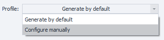

Once the settings are enabled, this window will appear:

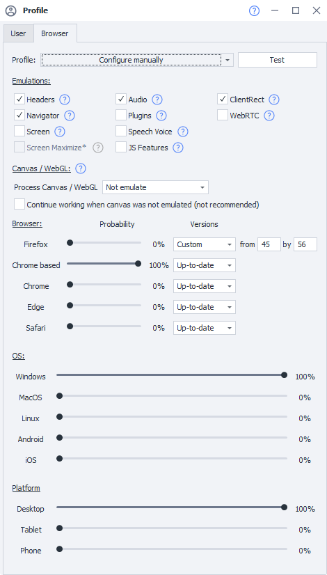

### Check
Once you’ve configured all the parameters, click this button to check that the **selected values are valid and compatible with each other**.
_______________________________________________  
### Emulations
Use these settings to enable or disable the blocks that make up the [browser fingerprint](https://ru.wikipedia.org/wiki/%D0%A6%D0%B8%D1%84%D1%80%D0%BE%D0%B2%D0%BE%D0%B9_%D0%BE%D1%82%D0%BF%D0%B5%D1%87%D0%B0%D1%82%D0%BE%D0%BA_%D1%83%D1%81%D1%82%D1%80%D0%BE%D0%B9%D1%81%D1%82%D0%B2%D0%B0).    

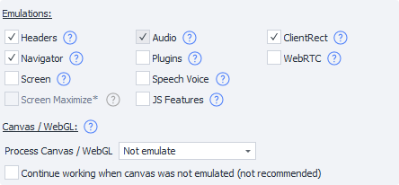  

> *Clicking the question mark next to any setting opens its help page.*

#### Headers
Each browser sends its own set of [HTTP headers](https://developer.mozilla.org/en-US/docs/Web/HTTP/Headers), such as `Accept`, `Accept-Encoding`, `Accept-Charset`, `Accept-Language`. In ZennoPoster, you can change these headers using profile actions or C# code.  

When you create a new profile, values in the [Headers](https://developer.mozilla.org/en-US/docs/Web/HTTP/Headers) block are automatically selected to correctly match the data in the [Navigator](https://developer.mozilla.org/ru/docs/Web/API/Navigator) block.

#### Navigator
This block contains a valid set of fields and values typical of the selected browser profile. 

When Navigator emulation is enabled, not only are the field values changed, but their visibility is also adjusted. What you previously had to configure manually using large snippets is now done automatically.

#### [Screen](https://developer.mozilla.org/ru/docs/Web/API/Screen)
This block controls screen parameters, including its resolution.  

Previously, you could emulate these values using profile actions or C# code. Now they’re set automatically and coordinated with the current Navigator data and other profile blocks.  

#### Screen Maximize  
> *Available in **ZennoPoster 7.3.0.0 and later**. The **Screen** block must be enabled for this setting to work.*  

Automatically sets the browser window size according to the generated **Screen** parameters.

**Equivalent C# method:** `SetWindowSize`.

:::warning Note
On some websites, using this setting may cause layout issues.
:::

#### Plugins
Each browser supports sets of plugins that vary depending on its type, operating system, and platform. We provide a universal set of plugins that will be installed automatically.

#### Audio
ZennoPoster can also automatically emulate the browser’s audio context and some of its audio environment parameters. This is what the [Audio](https://developer.mozilla.org/ru/docs/Web/API/AudioContext "https://developer.mozilla.org/ru/docs/Web/API/AudioContext") block is for.

#### Speech Voice
:::info *Available starting with version 7.3.0.0*
:::

The [Web Speech API](https://developer.mozilla.org/ru/docs/Web/API/Web_Speech_API "https://developer.mozilla.org/ru/docs/Web/API/Web_Speech_API") lets you interact with voice interfaces for speech recognition and synthesis.  

Speech Voice is a set of voice presets used to generate audio representations of information.

#### Canvas / WebGL
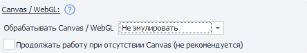  

What are Canvas and WebGL?

Canvas is an HTML5 element designed for creating graphics on web pages.

WebGL is an API for drawing 3D graphics in a browser.  

They can be used to create browser fingerprints. For example, using WebGL Image.

Fingerprinting works roughly like this: a hidden image is rendered on a website, and a hash is then generated from it. The result varies across devices because of differences in hardware, drivers, and browsers. This variation makes it possible to track users.

**Starting with version 7.7.0.0, we’ve significantly improved Canvas/WebGL emulation.**

There are now three ways to use it:

- **Do not emulate**. The same browser fingerprint is used for all profiles created.
- **Add noise**. Creates a new fingerprint for each profile.  
However, the resulting fingerprint looks unnatural because it’s unique. Ordinary browsers rarely have fingerprints like this. But this mode is sufficient for most websites.
- **Super emulation** ***(Chromium engine only)***. Generates the most natural-looking fingerprint, helping you blend in with the crowd since many similar devices exist around the world.  

:::warning Use GPU to accelerate rendering
You need to enable this setting in “Instance” for WebGL to work in the browser.
:::

##### Continue working if Canvas is unavailable (*not recommended*)  
This setting allows the project to continue if Canvas generation fails.  

When it’s **disabled**, the template ends with an error if Canvas cannot be generated.

#### JS Features
Browsers can be checked using many sophisticated techniques. For example, calling the `toString()` function on any object, or using other **JavaScript functions**, can reveal a lot about your browser.  

The **JS Features** block is designed to protect against these kinds of browser detection techniques.

#### ClientRect
Element sizes, their applied styles, and other details can reveal information about your hardware.  

Enabling the **ClientRect** block protects your browser against this type of fingerprinting.

#### WebRTC
Any devices — cameras, headphones, and microphones — may be visible in your browser through [WebRTC](https://developer.mozilla.org/ru/docs/Web/API/WebRTC_API). They can also provide a reliable browser fingerprint.  

The **WebRTC** block provides a universal set of devices for the selected platform, OS, and browser.
_______________________________________________
### Browser
Use the sliders to adjust the probability of generating a particular browser.  

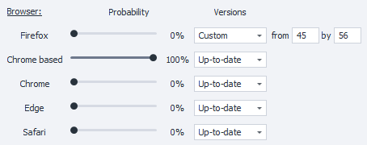

:::warning This generates the *User-Agent* value
This string is sent with the request and contains information about the browser, OS, and its bitness, as well as other information.  

Don’t confuse this with the *Browser type* in the current project, which you can change in **Project settings**.
:::

#### Operating system and Platform
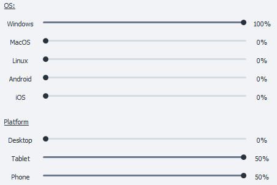

Use the sliders to adjust the probability of generating a particular platform and OS.

_______________________________________________ 
## What is the Profile for?     
For registering on websites, forums, blogs, social networks, and so on. It saves you from having to figure out where to get first names, last names, postal codes, cities, and logins, or how to generate different device parameters. All of this is already built into the program, so you can focus on more important tasks.

_______________________________________________ 

## Useful links

- [❗→ Profile window](https://zennolab.atlassian.net/wiki/spaces/RU/pages/735903758 "https://zennolab.atlassian.net/wiki/spaces/RU/pages/735903758")
- [❗→ Profile operations](https://zennolab.atlassian.net/wiki/spaces/RU/pages/486539291 "https://zennolab.atlassian.net/wiki/spaces/RU/pages/486539291")
- [❗→ Profile (PM)](https://zennolab.atlassian.net/wiki/spaces/RU/pages/735608848 "https://zennolab.atlassian.net/wiki/spaces/RU/pages/735608848")