---
sidebar_position: 2
title: "Appearance"
description: ""
date: "2025-08-25"
converted: true
originalFile: "Внешний вид.txt"
targetUrl: "https://zennolab.atlassian.net/wiki/spaces/RU/pages/735576065"
---
import DisclaimerNotice from '@site/src/components/DisclaimerNotice';

<DisclaimerNotice />

> 🔗 **[Original page](https://zennolab.atlassian.net/wiki/spaces/RU/pages/735576065)** — Source of this material

_______________________________________________  
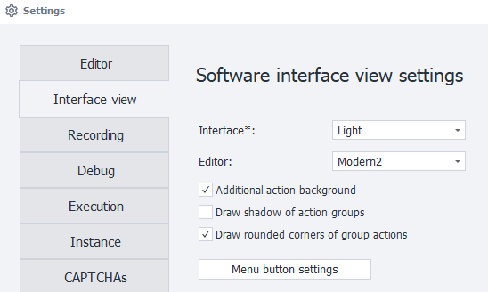

## Interface
Choose between a light or dark theme for the program interface. This setting changes the appearance of windows, menus, and other ProjectMaker elements.

### Light: {#light-interface}

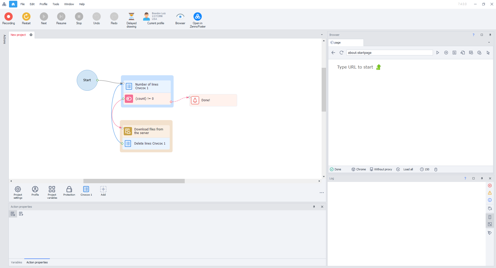

### Dark: {#dark-interface}

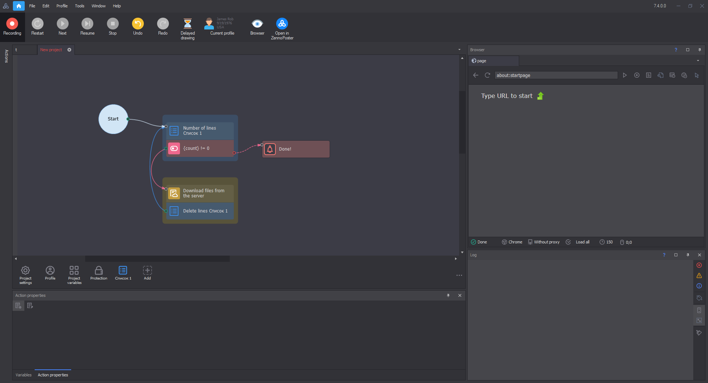

:::info To change the interface theme, you need to restart the program
:::
_______________________________________________
## Editor
Choose an editor theme. The appearance of actions will change depending on the selected theme. 

This setting does not affect project execution.

### Modern1 {#modern1-editor}
> **The modern appearance selected by default**

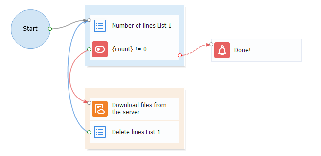

### Modern2 {#modern2-editor}
> **The backgrounds of some icons change; everything else stays the same**

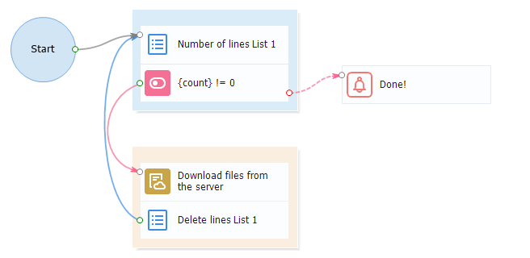

### Letter {#letter-editor}
> **Icons are replaced with letters and symbols**

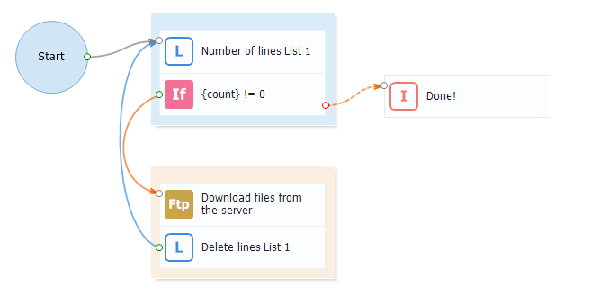

### Classic {#classic-editor}
> **The program's earlier appearance, with a completely different set of icons**  

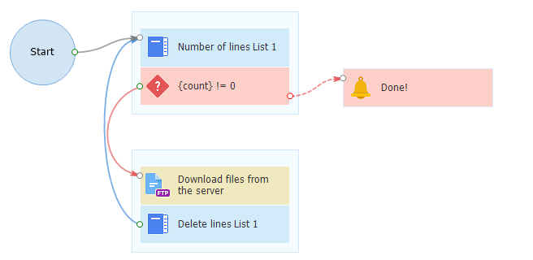

### Classic2 {#classic2-editor}
> **Action backgrounds become more saturated**

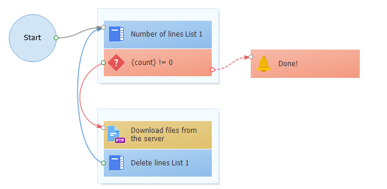

_______________________________________________
## Additional Action Background
:::info NOT AVAILABLE FOR *CLASSIC* AND *CLASSIC2*
:::

| With additional background | Without additional background |
| -------- | ------- |
| 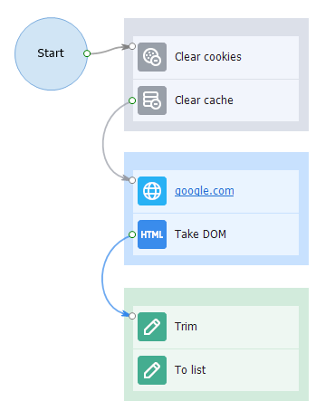 | 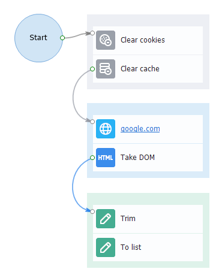 |

_______________________________________________ 
## Draw Shadow for Action Groups
Adds a shadow around action groups to visually separate them from other project elements.  

:::warning Enabling this setting may slow down rendering
:::

| Setting enabled | <mark id="06ec7f47-93ca-4339-9960-a3d675f15fe0" data-renderer-mark="true" data-mark-type="annotation" data-mark-annotation-type="inlineComment" aria-details="06ec7f47-93ca-4339-9960-a3d675f15fe0" data-mark-annotation-state="active" data-has-focus="false" data-is-hovered="false">Setting disabled</mark> |
| -------- | ------- |
|  | 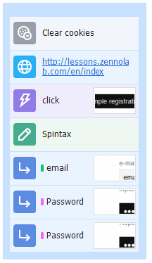 |

_______________________________________________ 
## Draw Rounded Corners for Actions and Groups
:::info *Added in 7.4.0.0*
:::

When you enable this setting, actions and action groups are displayed with rounded corners.

| Setting enabled | Setting disabled |
| -------- | ------- |
| 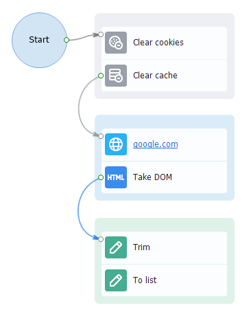 | 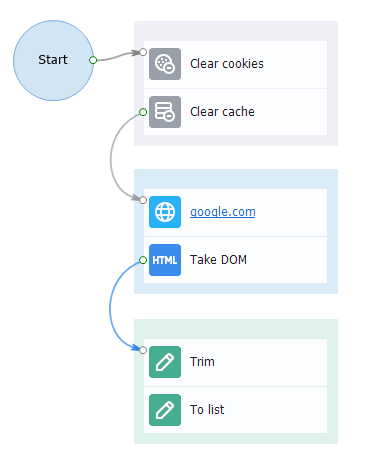 |

_______________________________________________ 
## Menu Button Settings
Click this button to open an additional menu where you can choose which tool and section buttons appear at the top of the program. This lets you keep only frequently used features visible.

### Tool Button Settings
Select which tool buttons to display in the top menu.

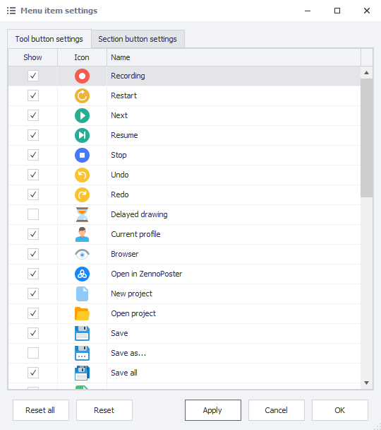

Once you select the desired buttons and click **Apply**, they immediately appear on the toolbar:

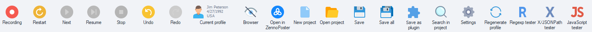

### Section Button Settings
Select which sections to display at the very top of the program.

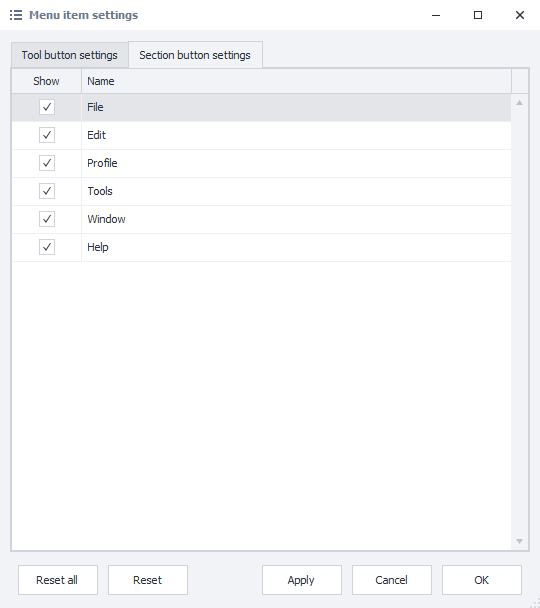

Once you select the necessary sections, they appear in the main menu:

### Button Arrangement
You can manually arrange buttons and sections in the order that suits you. To do this, hold down the left mouse button on the desired item and drag it to the position you want.

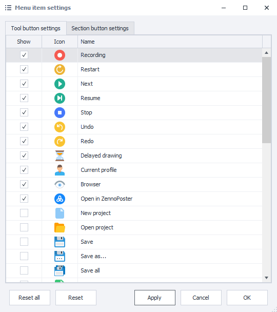

With **Reset**, you can return the items in the current settings window to their default positions.  

**Reset All** returns the buttons in both windows to their default arrangements.