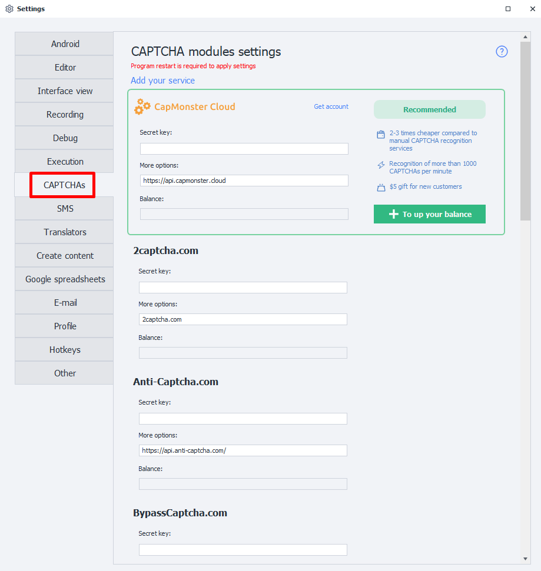
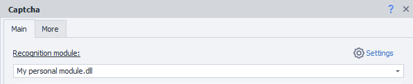

---
sidebar_position: 7
title: "Captchas (PM)"
description: ""
date: "2025-08-25"
converted: true
originalFile: "Капчи (PM).txt"
targetUrl: "https://zennolab.atlassian.net/wiki/spaces/RU/pages/735772673/PM"
---
import DisclaimerNotice from '@site/src/components/DisclaimerNotice';

<DisclaimerNotice />

> 🔗 **[Original page](https://zennolab.atlassian.net/wiki/spaces/RU/pages/735772673/PM)** — Source of this material

_______________________________________________  
## Description
A **CAPTCHA** is an automatically generated test used to determine whether a user is a human or a computer (bot). Simple CAPTCHAs often consist of distorted letters and/or digits. They may use different color combinations, noise, distortions, additional lines, or arbitrary shapes.  

|  | 
| :--------: | 
| **Examples of text CAPTCHAs.** |  

Other types of CAPTCHA require an action rather than simply entering characters from an image. For example, you may be asked to find buses, palm trees, motorcycles, or other objects; solve a puzzle; arrange objects in a particular order; or sort them.  

#### More CAPTCHA examples:  

|  |  |
| :--------: | :-------: |
| [**ReCaptcha**](https://developers.google.com/recaptcha) | [**HCaptcha**](https://www.hcaptcha.com/) |  

|  |  |
| :--------: | :-------: |
| [**FunCaptcha**](https://www.arkoselabs.com/arkose-matchkey/) | [**CloudFlare**](https://www.cloudflare.com/) |
_______________________________________________
## What are these settings for?
ZennoPoster lets you solve text CAPTCHAs manually. Simply select the `MonkeyEnter.dll` module in the [**Recognize CAPTCHA**](/zennoposter/ProjectMaker/Project-editor/Actions-in-ProjectMaker-Actions-Blocks/Tabs/Captcha_Recognition) action. However, this can become labor-intensive when you need to solve hundreds or even thousands of CAPTCHAs!  

What if, for example, the project runs around the clock and a CAPTCHA can appear at any time?

The services listed here can help. **They let you avoid entering CAPTCHAs manually**.  

  
_______________________________________________
## How do I connect a service?  
  
### Secret key  
Most services require an **API key**. This is a *unique string of random characters* that the service uses to identify you. For example, it might look like this: `8fc9b30e544885b8480fb590dfcbdd71`.  

To obtain an API key, visit the website of a suitable service and review its terms. Once you have chosen a CAPTCHA-solving service, register and obtain your *API key* from your account dashboard.  

### Login and password  
Some services use the login and password you chose during registration instead of an API key.  

### More options
This field contains the **URL (domain)** that receives API requests. It is set by default in the program and **should not be changed unless necessary**. If no URL is provided, consult the documentation for the selected service.  

### Balance  
Once you have authenticated with the service, this field displays your current balance.  

It is also used to display error information, although not all services support this.  
Possible errors include `IP_BANNED`, `ERROR_WRONG_USER_KEY`, and others. 

:::warning **If this field remains empty after you enter the API key**
An error has occurred.  

Possible causes include an incorrect key (or login/password), a problem with the service, or a banned key.
:::
_______________________________________________
## Available services  
- [**CapMonster Cloud**](https://capmonster.cloud/) — Recommended 👍;    
- [2captcha](https://2captcha.com/);  
- [Anti-Captcha](https://anti-captcha.com/);  
- [BypassCaptcha](http://bypasscaptcha.com/);  
- [CheapCaptcha](https://cheapcaptcha.com/);  
- [DeathByCaptcha](https://deathbycaptcha.com/);  
- [DeCaptcher](http://decaptcher.com/);  
- [Imagetyperz](http://imagetyperz.com/);  
- [Jsdati](https://www.jsdati.com/);  
- [RuCaptcha](https://rucaptcha.com/);  
- [CapMonster 2 Desktop](https://zennolab.com/ru/products/capmonster/);  
_______________________________________________
## Custom module
### Adding a new module (service)  
You can also add your own CAPTCHA-solving service based on the API of a popular service.  

  
### Required parameters 
:::tip **If you are not sure which details to enter**
Consult the service provider.
:::
#### Module name  
Enter a name for the module, up to **20 characters** long.  

#### API  
Select the service API on which your module will be based.  

#### API-key
The service key. This is the same key you enter in the **Secret key** field when connecting the service.  

#### Server  
The URL (domain) to which CAPTCHA-solving requests will be sent.  

### Sending CAPTCHAs to your module
After adding the module, you can select it in the [**Recognize CAPTCHA**](/zennoposter/ProjectMaker/Project-editor/Actions-in-ProjectMaker-Actions-Blocks/Tabs/Captcha_Recognition) action.  

  

### Removing a module  
To remove a custom module from the program, **delete these two files**:  
- `c:\Users\USERNAME\AppData\Roaming\ZennoLab\Configs\ИмяМодуля.dll.config`  
- `c:\Users\USERNAME\AppData\Roaming\ZennoLab\CustomModules\Captcha\ИмяМодуля.dll`  

:::warning **We recommend closing ZennoPoster and ProjectMaker before deleting these files**
:::
_______________________________________________ 