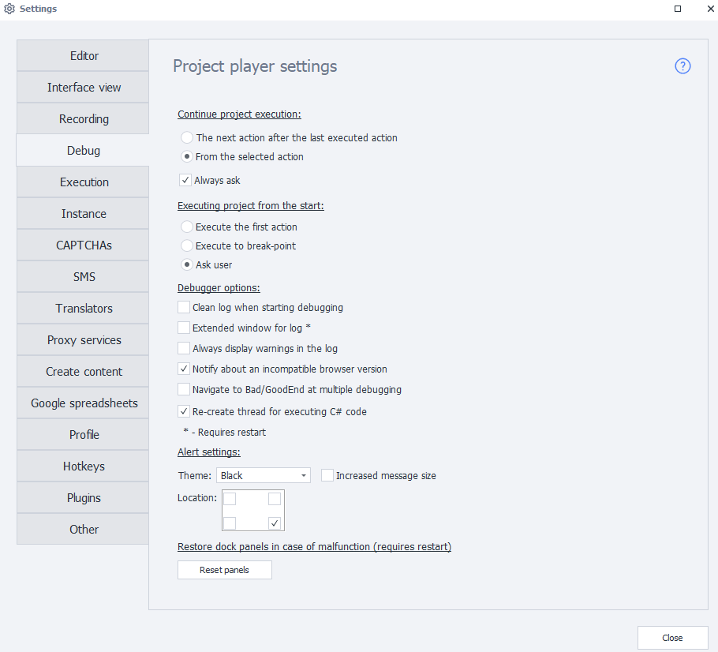
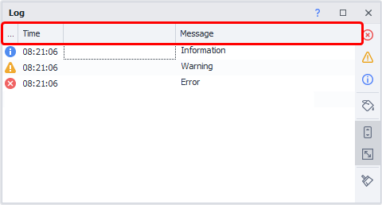
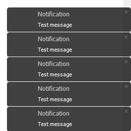
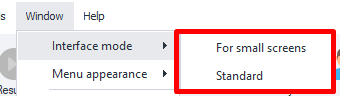

---
sidebar_position: 4
title: "Debugging"
description: ""
date: "2025-08-25"
converted: true
originalFile: "Отладка.txt"
targetUrl: "https://zennolab.atlassian.net/wiki/spaces/RU/pages/725352498"
---
import DisclaimerNotice from '@site/src/components/DisclaimerNotice';

<DisclaimerNotice />

> 🔗 **[Original page](https://zennolab.atlassian.net/wiki/spaces/RU/pages/725352498)** — Source of this material

_______________________________________________  


## Where project execution will continue from
These settings control how the project behaves when you click the **Next** or **To End** buttons.

### Next action after the last executed one
The project will continue from the next action after the last one that was completed.  

### From the selected action
The project will continue execution from the action you currently have selected in the project diagram.

### Always ask
This checkbox determines whether you are prompted to choose between the two options above every time you resume execution.
_______________________________________________ 
## Running the project from the start
This setting controls how the project behaves when you click **From Start**.  

### Execute the first action
When you select this option, clicking **From Start** moves the project's focus to the first action.

### Execute up to breakpoint 
Actions run up to the first **breakpoint**, or to the end of the project if there are no breakpoints.

### Ask 
You will be prompted to choose the execution behavior each time.
_______________________________________________ 
## Debugger options
### *Delayed execution visualization*
:::warning *Removed from the program starting with version 7.1.7.0*
:::

*Enables real-time visualization of actions being performed. This setting is useful when debugging long projects and projects with loops.*

### Clear the log at the start of debugging
Each time the project is run **From Start**, the log is cleared automatically.

### Extended log window
The log will be displayed in a window with extra options and the ability to copy text.

:::info THIS SETTING IS ENABLED FOR BOTH ZENNODROID AND PROJECTMAKER AT THE SAME TIME
:::

  

> **A restart is required to apply this option**

### Always show warnings in the log
Additional warnings will appear in the log. For example:  
- `Выполнение логического оператора If Результат: false` if the [**IF**](../Project-editor/Actions-in-ProjectMaker-Actions-Blocks/Logic/IF_Condition) action follows the red branch.  

:::info A restart is required
:::

### Show warning about unsupported browser version
Displays a warning in the log if the main and nested projects use different browser engine versions.  

This can happen when using the [Project in Project](/zennoposter/ProjectMaker/Project-editor/Actions-in-ProjectMaker-Actions-Blocks/Project/Project_in_Project_Nested_Projects) action if a different browser type is selected in the nested project's [settings](/zennoposter/ProjectMaker/Project-editor/Static_blocks/Project_Settings). For example, the main project uses Firefox 52 and the nested project uses Firefox 45.  

If this setting is enabled, the following warning appears in the log when the nested project starts:
```
Выполнение действия ProjectInProject. Текущий браузер Firefox52 не подходит для вложенного проекта, требуется Firefox45. Возможна некорректная работа вложенного проекта.
```

### Switch to Bad/GoodEnd on multiple debug runs
Allows execution to enter the [BadEnd](/zennoposter/ProjectMaker/Project-editor/Actions-in-ProjectMaker-Actions-Blocks/Logic/BadEnd_Exit_on_Error) and [GoodEnd](/zennoposter/ProjectMaker/Project-editor/Actions-in-ProjectMaker-Actions-Blocks/Logic/GoodEnd_Successful_Exit) blocks repeatedly while debugging a project.

The destination depends on the result:
- BadEnd if an error occurs;
- GoodEnd if execution completes successfully.

:::info If this setting is disabled
Execution can enter BadEnd or GoodEnd only once per project run.  

To enter either block again, restart the project using **From Start**.
:::

### Recreate C# code execution thread
This setting may help avoid memory leaks in ProjectMaker on AMD processors when executing C# code. The underlying bug is in .NET Framework.  

:::warning Cannot be used with ThreadStatic
If you use C# with [ThreadStatic](https://www.c-sharpcorner.com/article/overview-of-threadstatic-attribute-in-c-sharp) in your projects, disable this setting.
:::

_______________________________________________
## Notification settings  
This setting controls [**notifications**](../Project-editor/Actions-in-ProjectMaker-Actions-Blocks/Logic/Notification_Log_Entry) that appear on the desktop.  

  

### Theme.  
Choose the notification background color:  
- **Black**, black;  
- **White**, white;  
- **Blue**, blue;  
- **Green**, green;  
- **Orange**, orange;  
- **WhiteRed**, red and white. 

### Large message size.  
Notifications will be shown in a larger format.  

### Location.  
Choose where notifications appear on the desktop:  
- *bottom right (default)*;  
- *bottom left*;  
- *top left*;  
- *top right*.  
_______________________________________________
## Resetting dock panel positions if something goes wrong  
The **Reset panels** button restores the default arrangement of program windows if you have undocked, moved, or closed them.  

:::tip **Windows are also reset when you change the *Interface Mode*.**  

:::
_______________________________________________  
