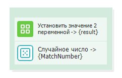
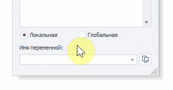
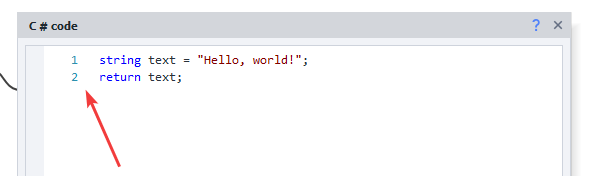
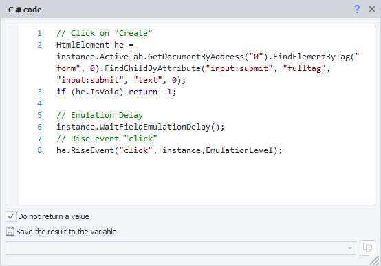
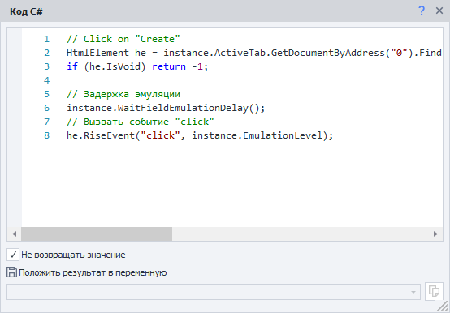

---
sidebar_position: 1
title: "Editor"
description: ""
date: "2025-08-25"
converted: true
originalFile: "Редактор.txt"
targetUrl: "https://zennolab.atlassian.net/wiki/spaces/RU/pages/725385223"
---
import DisclaimerNotice from '@site/src/components/DisclaimerNotice';

<DisclaimerNotice />

> 🔗 **[Original page](https://zennolab.atlassian.net/wiki/spaces/RU/pages/725385223)** — Source of this material

_______________________________________________  
## Project Editor Settings

### Open previously opened projects on startup
When ProjectMaker starts, all projects that were open before you last closed the program will be reopened automatically.

### Draw an element screenshot (if available)
The action block will display a screenshot of the corresponding page element. 

> **This helps you navigate the project more easily, but increases the template file size.**

### Do not fill action settings cache
Disables preloading the action settings cache. This speeds up program startup.

### Show resulting variable in action description
If an action saves its result to a variable, the variable name is displayed directly in the block description:  

`Название действия → {-Variable.ИмяПеременной-}`

This lets you see where the result is saved without opening the action settings.

### Sort project variables alphabetically
Lists project variables in alphabetical order, making it easier to find the variable you need in large projects.

### Use autocomplete in dropdown lists
When you enter the name of a variable, list, or table, ProjectMaker suggests matching items. You do not need to type the full name — just select it from the list.  

:::info Restart the program to apply this setting
:::

### Do not prompt to save new project
Disables the prompt to save a new project after clicking the **From Start** button.  

### Offer to create actions for a new line
Automatically opens a list of available actions when you create a new line from a block. You can select the next action from this list and add it directly to the project.

### Show quick actions window
When you hover over a block's connection point, a window for quickly navigating to other actions appears. This makes it easier to work with connections between project blocks.
_______________________________________________ 
## Action Properties
### Limit action property width
Determines how the grid width changes in the **Action Properties** window:  
- when enabled, the width is fixed;
- when disabled, the content adapts to the window size.

### Open multiple action settings at once in "..." mode
Lets you open the settings of several actions at once, next to their corresponding blocks.

> **By default, this is only enabled in *No browser* mode.**  
_______________________________________________
## Other
### Max log message height before scroll
Sets the maximum height of a single log entry.  

If a message does not fit in this area, a scrollbar appears within it.

### Variable list cell height before scroll
Sets the maximum cell height in the Variables window. A scrollbar appears if the content does not fit.

### Number of rows in static blocks before scroll
Determines how many rows are visible in a static block. A scrollbar appears if there are more rows than the specified value.

### Remember number of recently opened projects
Determines how many recently opened projects appear on the [start page](/zennoposter/ProjectMaker/Start_Page).  

### Autosave timeout
Sets the interval, in minutes, at which the project is saved automatically.

### C# Snippet Directory
Specifies the folder from which ProjectMaker loads [C# snippets](/zennoposter/ProjectMaker/Project-editor/Actions-in-ProjectMaker-Actions-Blocks/Custom_code/CSharp_Code).  

**The following folder is used by default:**
`C:\Users\USERNAME\AppData\Roaming\ZennoLab\ZennoPoster\7\Snippets\` 

> *`USERNAME` is the Windows user account under which the program is running.*

### C# code font
Lets you select the font and size for the [C# code](/zennoposter/ProjectMaker/Project-editor/Actions-in-ProjectMaker-Actions-Blocks/Custom_code/CSharp_Code) editor.  

> **The default is *Lucida Console*, size *8*.**

### Remember cursor position in C# block
When enabled, the editor opens the code at the line where the cursor was when you closed the block.  

When disabled, the editor returns to the location of the last code change.

### Line numbering in C# block by default
Automatically displays line numbers in new C# blocks.  

### Line wrapping in C# block by default
Automatically wraps long lines of code that do not fit the window width. The code itself does not change — only its display in the editor changes.

| With line wrapping enabled: | Line wrapping disabled: |
| -------- | ------- |
|  |  |

### Bulk encryption of projects
Lets you encrypt all projects currently open in ProjectMaker at once.