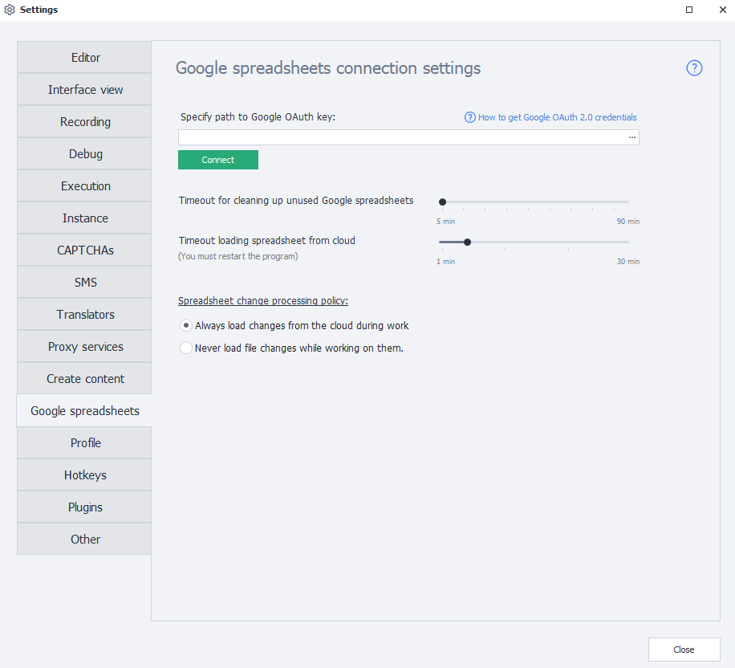

---
sidebar_position: 13
title: "Google Sheets (PM)"
description: ""
date: "2025-08-25"
converted: true
originalFile: "Google таблицы (PM).txt"
targetUrl: "https://zennolab.atlassian.net/wiki/spaces/RU/pages/735576090/Google+PM"
---
import DisclaimerNotice from '@site/src/components/DisclaimerNotice';

<DisclaimerNotice />

> 🔗 **[Original page](https://zennolab.atlassian.net/wiki/spaces/RU/pages/735576090/Google+PM)** — Source of this material

_______________________________________________  
## Configuring Google Sheets.  
This article covers **only** *configuring Google Sheets* in the program. [The connection process is described here](/zennoposter/ProjectMaker/Recording-and-creating-projects/Setting_Up_Google_Sheets_Connection).  

### Appearance.

### Path to the Google OAuth key.  
Here, select the path to the file with [Google API connection settings](/zennoposter/ProjectMaker/Recording-and-creating-projects/Setting_Up_Google_Sheets_Connection).  

:::warning **The file must have the `.json` extension.**
:::  

### Timeout for clearing unused Google Sheets.  
This setting determines how long a sheet is kept in memory.  

If no project in ZennoPoster uses a Google Sheet for the number of minutes specified in this setting, the sheet will be unloaded from memory to save computer resources.  

A **long timeout** can be useful when there’s a pause between runs of a particular project (for example, when it runs hourly on a schedule). This way, the sheet won’t need to be downloaded from the cloud each time.  

A **short timeout** is useful if each time the project runs, it generates a report that’s saved to a new sheet. In this case, there’s no need to keep these sheets in memory after the data has been uploaded.  

### Timeout for downloading a sheet from the cloud.  
Here, specify how long to allow for downloading a sheet from the cloud.

If a sheet is large, synchronization can sometimes take a long time. This can cause a download error because the request takes too long to complete.  

### Sheet changes processing policy.  
This setting lets you choose whether ZennoPoster should download external changes to a sheet while working with it.  

If you select **Never download external changes while working**, the program will *only send* local data without comparing it with the data in the cloud. This means the program won’t spend your time or computer resources on this. This is useful for large sheets.  

Disabling synchronization is also useful when parsing data if you don’t need the latest data from the cloud.
_______________________________________________ 
## Useful links:

- [❗→ Configuring the Google Sheets connection](https://zennolab.atlassian.net/wiki/spaces/RU/pages/1667727363 "https://zennolab.atlassian.net/wiki/spaces/RU/pages/1667727363")
- [❗→ Google Sheets operations](https://zennolab.atlassian.net/wiki/spaces/RU/pages/509411347 "https://zennolab.atlassian.net/wiki/spaces/RU/pages/509411347")
- [❗→ Google Sheet](https://zennolab.atlassian.net/wiki/spaces/RU/pages/724566092 "https://zennolab.atlassian.net/wiki/spaces/RU/pages/724566092")
- [❗→ Multithreaded work with Google Sheets (version 7.1.7.0 and later)](https://zennolab.atlassian.net/wiki/spaces/RU/pages/851673094 "https://zennolab.atlassian.net/wiki/spaces/RU/pages/851673094")