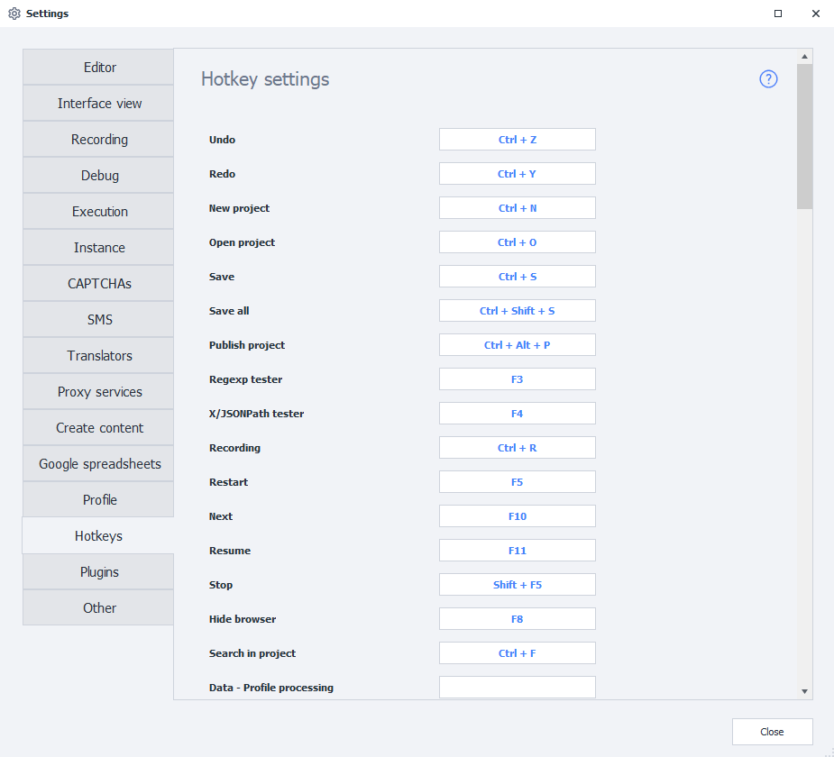

---
sidebar_position: 16
title: "Hotkeys"
description: ""
date: "2025-08-25"
converted: true
originalFile: "Горячие клавиши.txt"
targetUrl: "https://zennolab.atlassian.net/wiki/spaces/RU/pages/475332762"
---
import DisclaimerNotice from '@site/src/components/DisclaimerNotice';

<DisclaimerNotice />

> 🔗 **[Original page](https://zennolab.atlassian.net/wiki/spaces/RU/pages/475332762)** — Source of this material

_______________________________________________  
## Description.
You can assign keyboard shortcuts in the program settings to make working with it easier.  

_______________________________________________
## Keyboard shortcuts. 
| Keys              | Function | 
| :----------------: | :------ | 
| `LMB on an action` + `Enter/Space`        |   Opens the settings for this action in a floating window    | 
| `Esc`           |   Closes the action settings   | 
| `Clrl` + `C`    | Copies the selected action   | 
| `Ctrl` + `X` |  Cuts the selected action   |  
| `Ctrl` + `V` |  Pastes an action from the clipboard where the cursor is   |  
| `Ctrl` + `Z` |  Undoes the last action   |  
| `Ctrl` + `Y` |  Redoes the last action   |  
| `Ctrl` + `N` |  Creates a new project   |  
| `Ctrl` + `O` |  Opens an existing project   |  
| `Ctrl` + `S` |  Saves the current project   |  
| `Ctrl` + `F` |  Searches the project   |  
| `Ctrl` + `Shift` + `S` |  Saves the current project   |  
| `Ctrl` + `Alt` + `P` |  Publishes the current project   |  
| `Delete` |  Deletes the selected action   |  
| `Up ᐃ` |  Moves the cursor up through the group or to the previous action    |  
| `Down ᐁ` |  Moves the cursor down through the group or to the next action coming from a successful exit   |  
| `Left ᐊ` |  Moves the cursor to the first incoming action or up through the group |  
| `Right ᐅ` |  Moves the cursor to the next action coming from a successful exit or down through the group  |  
| `Ctrl` + `Right ᐅ` |  Moves the cursor to the next action coming from an unsuccessful exit  |  
| `PageUp` |  Moves to the first action in the group   |  
| `PageDown` |  Moves to the last action in the group   |
| `F3` |  Opens the [regular expression constructor](/zennoposter/ProjectMaker/Tools/Regular_Expression_Tester)   |
| `F4` |  Opens the [X/JSON Path tester](/zennoposter/ProjectMaker/Tools/X_JSON_Path_Tester)   |  
| `F8` |  Hides the browser   |
_______________________________________________  
## Mouse operations.
| Combinations              | Function | 
| :----------------: | :------ | 
| `Double-click LMB on an action`  |   Opens its settings    | 
| `Hold down the mouse wheel` + `Move the mouse`   |   Moves around the project canvas   | 
| `Clrl` + `Scroll the mouse wheel`    | Zooms the canvas in/out   | 
| `Double-click LMB on an empty area of the canvas` |  Resets the zoom to 100%   |  
| `Double-click LMB on any output` + `Double-click LMB on another action's input` |  Creates a connection between them   |
_______________________________________________  
## Hotkeys for debugging a project.  
| Keys              | Function | 
| :----------------: | :------ | 
| `Clrl` + `R`  |   Enables/disables project recording   | 
| `F5`   |    Runs the project from the beginning   | 
| `F10`    | Moves to the next action   | 
| `F11` |  Runs the project until the first breakpoint   |  
| `Shift` + `F5` |  Stops execution   |  
_______________________________________________  
## Hotkeys for editing a C# macro.  
| Keys              | Function | 
| :----------------: | :------ | 
| `Clrl` + `C`  |   Copies the selection    | 
| `Ctrl` + `X` |   Cuts the selection   | 
| `Ctrl` + `V`    | Pastes the selection   | 
| `Ctrl` + `G` |  Goes to line number n   |  
| `Shift` + `Delete` |  Cuts the current line   |  
| `Ctrl` + `K` |  Comments out the selected lines   |  
| `Ctrl` + `U` |  Uncomments the selected lines   |  
_______________________________________________  
