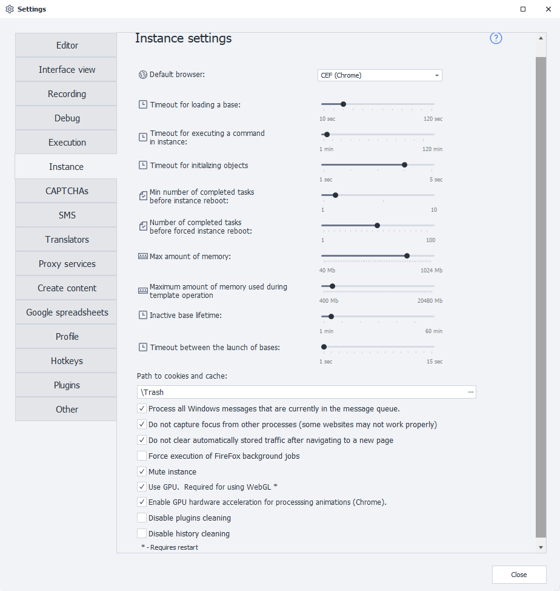

import DisclaimerNotice from '@site/src/components/DisclaimerNotice';

<DisclaimerNotice />

> 🔗 **[Original page](https://zennolab.atlassian.net/wiki/spaces/RU/pages/735608841/PM)** — Source of this material

_______________________________________________  



### Default browser
Determines which browser will launch by default.  

You can select a different browser for an individual template:  
- in [Project Settings](/zennoposter/ProjectMaker/Project-editor/Static_blocks/Project_Settings);
- using the [Launch instance](/zennoposter/ProjectMaker/Project-editor/Actions-in-ProjectMaker-Actions-Blocks/Browser/Browser_settings) action.

:::warning This setting is only available in ProjectMaker
:::

### Instance pool loading timeout
Sets the time allowed to start a new thread within an already running process.

### Instance command execution timeout
Sets the maximum time to wait for a command to run in an instance, including any action.  

### Object initialization wait timeout 
Sets additional time for the web page and its elements to load. This may be necessary, for example, to display a CAPTCHA or dynamic content.  

If the page doesn't load in time and the log shows **“HTML element not found”**, try increasing this value.  

:::info Increasing the timeout may increase the project's overall execution time
:::

### Minimum number of tasks before reload
Sets the minimum number of tasks that must be completed before the instance pool is reloaded.  

### Tasks completed before forced reload
Sets the number of completed tasks after which the instance pool will be forcibly reloaded, regardless of their results.  

> You can manually restart an instance using the [Reload instance](/zennoposter/ProjectMaker/Project-editor/Actions-in-ProjectMaker-Actions-Blocks/Browser/Browser_settings) action in a template.  

### Maximum memory 
Sets the maximum amount of memory that one instance can use. If this value is exceeded, the instance pool will be marked for a forced reload.  

### Maximum memory usage while the template is running
Limits the amount of RAM available to one thread.  

If a thread exceeds the set limit, its execution will be forcibly stopped. The log will show this message:  
```
Проект остановлен из-за превышения лимита занимаемой памяти
```

:::info Added in 7.4.0.0
:::

### Inactive instance pool lifetime
Sets how long an inactive instance pool continues running before it is terminated.

### Timeout between pool launches 
Sets the delay between pool launches. This helps prevent CPU spikes, especially on low-powered computers.

### Cookie and cache path
Specifies the folder where temporary browser files are stored. We recommend using a folder inside the program directory.

Files downloaded through the ProjectMaker browser are also saved in this folder.

By default, the **`Trash`** folder in the installed program directory is used. Its path may look like this:
```
C:\Program Files\ZennoLab\RU\ZennoPoster Pro V7\7.4.0.0\Progs\Trash\
```

### Process all queued Windows messages
Allows the program to process all Windows events that occur while an instance is running.

### Don't steal focus from other processes 
Prevents ZennoPoster from stealing focus from other applications. This helps avoid screen flickering and unexpected changes to the active window.  

:::warning Check your projects after enabling this setting  
Some websites, such as **VK**, require the browser to receive focus to work correctly.
:::  

### Don't automatically clear traffic on Navigate 
Disables automatic clearing of the request log in the [Traffic window](/zennoposter/ProjectMaker/Program-interface/Traffic_Window) each time you navigate to a new page.  

You can control this setting for an individual project using [C# code](/zennoposter/ProjectMaker/Project-editor/Actions-in-ProjectMaker-Actions-Blocks/Custom_code/CSharp_Code):

```csharp
instance.ClearTrafficWhenNavigate = false; // Отключить очистку
instance.ClearTrafficWhenNavigate = true; // Включить очистку
```

### Force Firefox background tasks to run
Forces Firefox background tasks to continue running if an instance freezes.  

:::info We don't recommend enabling this setting 
if your projects don't experience unexplained freezes.
:::  

### Disable sound
Disables sound playback in the instance.

### Use GPU  
Uses the graphics card to accelerate content rendering in the instance.  

:::warning Must be enabled for WEBGL to work
:::  

### Use GPU hardware acceleration for animation processing in Chrome
Enables GPU-based animation rasterization in Chrome.

:::warning Enabling this setting may cause instability
if a supported graphics accelerator isn't available.
:::

### Disable plugin cleanup 
Disables automatic cleanup of Firefox plugins.

### Disable history cleanup
Disables automatic cleanup of Firefox history.