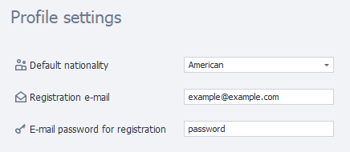
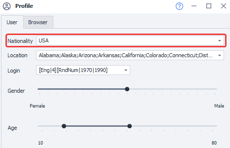
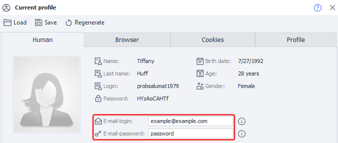

---
sidebar_position: 15
title: "Profile (PM)"
description: ""
date: "2025-08-25"
converted: true
originalFile: "Профиль (PM).txt"
targetUrl: "https://zennolab.atlassian.net/wiki/spaces/RU/pages/735608848/PM"
---
import DisclaimerNotice from '@site/src/components/DisclaimerNotice';

<DisclaimerNotice />

> 🔗 **[Original page](https://zennolab.atlassian.net/wiki/spaces/RU/pages/735608848/PM)** — Source of this material

_______________________________________________  
## Profile settings.  
 

Specify the characteristics that will be generated by default when the project starts.  
_______________________________________________
### Default nationality.  

   
Nationality for profile generation. You can also change it at the template level in the project profile settings.  
_______________________________________________
### Registration email.  
The *email* specified in this setting will be used for all new profiles.  
You can also change it by remapping fields in **Profile Operations**.  
The value is stored in the `{-Profile.Email-}` environment variable.  

  
_______________________________________________
### Registration email password.  
This *email password* will be used for all new profiles. You can also change it in  
**Profile Operations**. The value is stored in the `{-Profile.EmailPassword-}` environment variable.
_______________________________________________  
