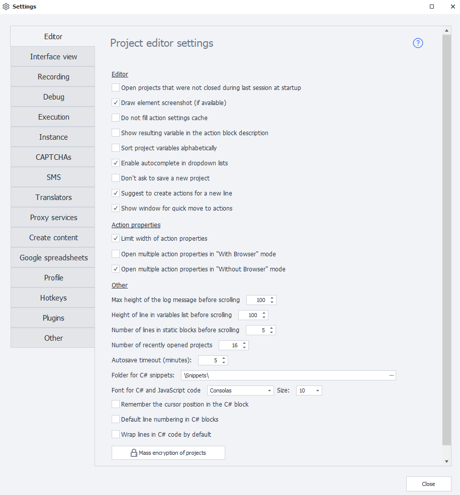

---
sidebar_position: 0
title: "ProjectMaker Settings"
description: ""
date: "2025-08-25"
converted: true
originalFile: "Настройки ProjectMaker.txt"
targetUrl: "https://zennolab.atlassian.net/wiki/spaces/RU/pages/475300064/ProjectMaker"
---
import DisclaimerNotice from '@site/src/components/DisclaimerNotice';

<DisclaimerNotice />

> 🔗 **[Original page](https://zennolab.atlassian.net/wiki/spaces/RU/pages/475300064/ProjectMaker)** — Source of this content

_______________________________________________  
## Description
ProjectMaker settings let you optimize the project recording process, configure logs, debug project execution, and much more.

### Sections
We’ve described each setting in detail in the corresponding sections:  
- [Editor](./Editor)
- [Appearance](./Appearance)
- [Recording](./Recording)
- [Debugging](./Debugging)
- [❗→ Execution (PM)](./Execution_PM)
- [❗→ Instance (PM)](./Instance_PM)
- [❗→ Captchas (PM)](./Captchas_PM)
- [❗→ SMS Services (PM)](./SMS_Services_PM)
- [❗→ Translators (PM)](./Translators_PM)
- [❗→ Proxy Services (PM)](./Proxy_Services_PM)
- [❗→ Content Creation (PM)](./Content_Creation_PM)
- [❗→ Google Sheets (PM)](./Google_Sheets_PM)
- [❗→ Mail (PM)](./Mail_PM)
- [❗→ Profile (PM)](./Profile_PM)
- [❗→ Hotkeys](./Hotkeys)
- [❗→ Settings. Plugins](./Settings_Plugins)
- [❗→ Other Settings (PM)](./Other_Settings_PM)

The **Execution**, **Instance**, **Captchas**, **Spintax**, and **Other** settings are duplicated in [❗→ ZennoPoster settings](https://zennolab.atlassian.net/wiki/spaces/RU/pages/494764084/ZennoPoster "https://zennolab.atlassian.net/wiki/spaces/RU/pages/494764084/ZennoPoster").
