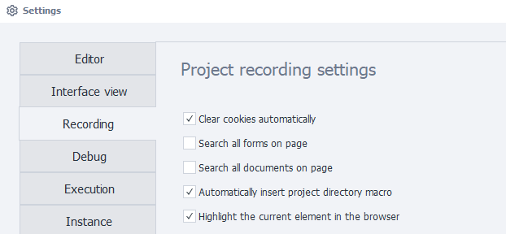
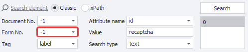
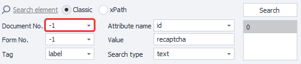
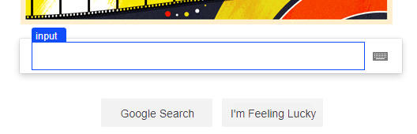

---
sidebar_position: 3
title: "Project Recording"
description: ""
date: "2025-08-25"
converted: true
originalFile: "Запись.txt"
targetUrl: "https://zennolab.atlassian.net/wiki/spaces/RU/pages/727777290"
---
import DisclaimerNotice from '@site/src/components/DisclaimerNotice';

<DisclaimerNotice />

> 🔗 **[Original page](https://zennolab.atlassian.net/wiki/spaces/RU/pages/727777290)** — Source of this material

_______________________________________________  
## Project recording settings
This tab contains settings that are activated when project recording is enabled.



### Automatically clear cookies
Automatically clears cookies when the project starts.  

> *This setting performs the same action as [Clear Cookies](/zennoposter/ProjectMaker/Project-editor/Actions-in-ProjectMaker-Actions-Blocks/Browser/Browser_settings#clear-cookies)*

### Search all forms on the page
Lets you search for elements in all forms on the page.  



> *This setting is used when working with the [Action Constructor](/zennoposter/ProjectMaker/Browser_Window/Action_Constructor_and_XPath_Search).*

### Search all documents on the page
Lets you search for elements in all documents on the page.  



> *This setting is used when working with the [Action Constructor](/zennoposter/ProjectMaker/Browser_Window/Action_Constructor_and_XPath_Search).*

### Automatically insert the project directory macro
Automatically replaces part of the file path with the project directory macro `{-Project.Directory-}`. 

This happens when the selected file is in the project folder or one of its subfolders. For example, this setting applies when specifying files in the properties of lists and tables.

### Highlight the current element in the browser
Highlights the selected HTML element with a blue border in the browser window.  

:::info You need to restart the program for this setting to take effect
:::



To display the border, ProjectMaker modifies the page DOM by adding the following elements to the end:

```html
<div id="zp_fr_hl_top_hl" style="visiblity:hidden"></div>
<div id="zp_fr_hl_left_hl" style="visiblity:hidden"></div>
<div id="zp_fr_hl_right_hl" style="visiblity:hidden"></div>
<div id="zp_fr_hl_bottom_hl" style="visiblity:hidden"></div>
<font id="zp_fr_hl_label" style="visiblity:hidden"></font>
```

:::tip Disable this setting
If modifying the DOM may affect anonymity or how the site works
:::