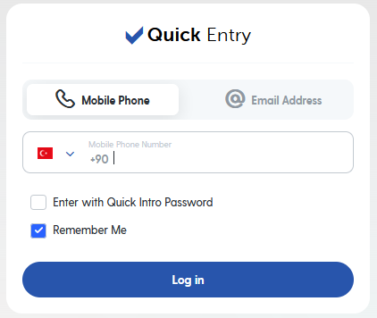
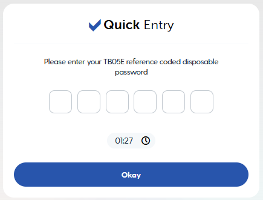
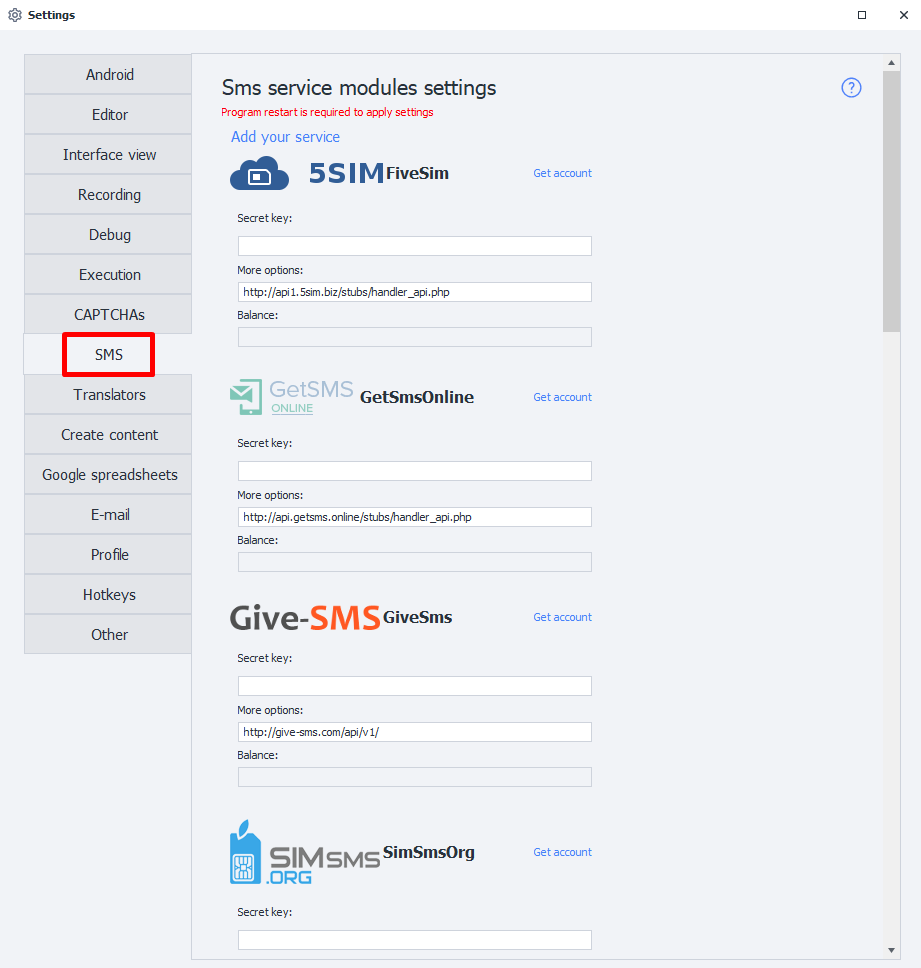
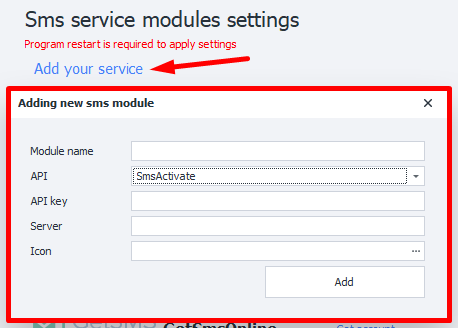
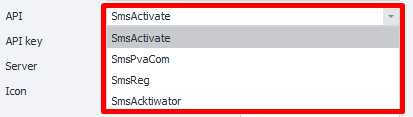
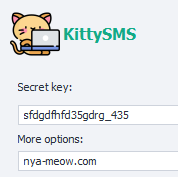
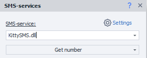

---
sidebar_position: 9
title: "SMS Services (PM)"
description: ""
date: "2025-08-25"
converted: true
originalFile: "SMS-сервисы (PM).txt"
targetUrl: "https://zennolab.atlassian.net/wiki/spaces/RU/pages/735576080/SMS-+PM"
---
import DisclaimerNotice from '@site/src/components/DisclaimerNotice';

<DisclaimerNotice />

> 🔗 **[Original page](https://zennolab.atlassian.net/wiki/spaces/RU/pages/735576080/SMS-+PM)** — Source of this material

_______________________________________________  
## Description  
Some websites require you to enter a mobile phone number to confirm your registration. A verification code will be sent to that number.  

|       | 
| :--------: | 
| **Examples of SMS requests for signing in.**  |

This is where third-party SMS services can come in handy. We'll do our best to make them easier to use.   
_______________________________________________ 

## How to connect?

### Secret key
Most services require what is known as an **API key**. This is a *unique string of random characters* that the service uses to identify you. For example, it might look like this: `8fc9b30e544885b8480fb590dfcbdd71`.  

To get an API key, go to the website of a service that suits your needs and review its terms. Once you've made your choice, sign up for the SMS service and get your *API key* from your account.  

### Additional parameters
Enter the **URL (domain)** for receiving API requests here. It's set by default in the program and **doesn't need to be changed unless necessary**. If the URL isn't already specified, check the documentation for your chosen service.  

### Balance  
Once you've authorized the service, your current balance will appear in this field.  

:::warning **If this field stays empty after you enter the API key**
This means an error has occurred. Possible causes include an incorrect key, service issues, or a banned key.
:::
_______________________________________________
## Available services  
- [5SIM Five Sim](http://5sim.net/);    
- [GetSmsOnline](http://getsms.online/);  
- [Give-SMS](http://give-sms.com/);  
- [SIMsmsOrg](http://simsms.org/);  
- [SMSAcktiwator](http://sms-acktiwator.ru/);  
- [SMS Activate](http://sms-activate.ru/ru/);  
- [SmsHub](https://smshub.org/);  
- [SMSpvaCom](http://smspva.com/);  
- [SMS-REG](http://sms-reg.com/);  
- [VAK-SMS](http://vak-sms.com/);  
- [virtualSMS](http://virtualsms.ru/);  
_______________________________________________  
## Your own service
### Add your own service (module)  
You can also add your own SMS receiving service based on the APIs of popular services.  

  

### Required parameters 
:::tip **If you're not sure what information to enter**
Please check with your service provider.
:::
#### Module name  
Enter a name for the new service, **up to 20 characters**.  

#### API  
  

Select the API of the service your module will be based on.  

#### API-key
The key for the service. This is the same key you enter in the **Secret key** field when connecting the service.  

#### Server  
The URL (domain) where requests to receive SMS messages will be sent.  

#### Icon  
The selected image will appear next to your module.  

  

Available formats: `jpg`, `bmp`, `gif`, `png`.

### Using the added service
Once you've added the module, you can select it in the action for working with [**SMS services**](/zennoposter/ProjectMaker/Project-editor/Actions-in-ProjectMaker-Actions-Blocks/Data/SMS_Processing_Services). You can then use it just like the built-in services. 

  

### Removing a module  
To remove the module you've created from the program, **you need to delete two files**:  
- `c:\Users\USERNAME\AppData\Roaming\ZennoLab\Configs\ИмяМодуля.dll.config`  
- `c:\Users\USERNAME\AppData\Roaming\ZennoLab\CustomModules\Sms\ИмяМодуля.dll`  

:::warning **We recommend closing ZennoPoster and ProjectMaker before deleting these files**
:::