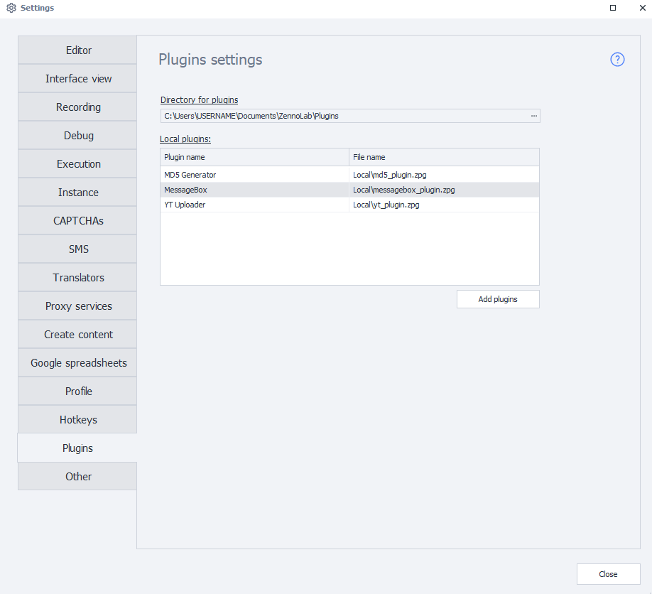
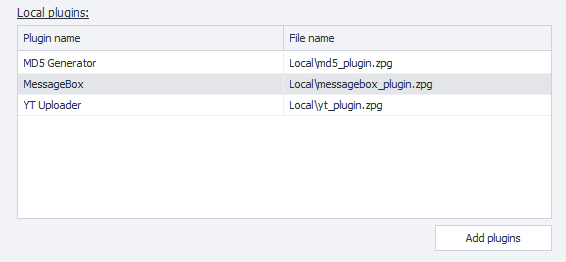
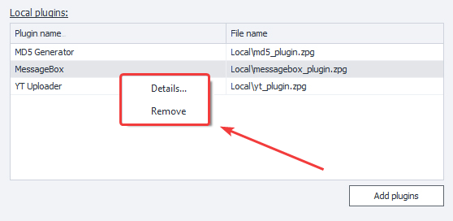
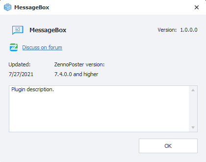

---
sidebar_position: 17
title: "Plugin settings"
description: ""
date: "2025-08-25"
converted: true
originalFile: "Настройки. Плагины.txt"
targetUrl: "https://zennolab.atlassian.net/wiki/spaces/RU/pages/735379481"
---
import DisclaimerNotice from '@site/src/components/DisclaimerNotice';

<DisclaimerNotice />

> 🔗 **[Original page](https://zennolab.atlassian.net/wiki/spaces/RU/pages/735379481)** — Source of this material

_______________________________________________  
:::info This page describes plugin settings
For more information about the plugins themselves, see the [article](/zennoposter/ProjectMaker/Project-editor/Actions-in-ProjectMaker-Actions-Blocks/Plugins).
:::

## Plugin directory
Specifies the folder where installed plugins are stored.

:::warning When changing the directory after installing plugins
You need to move previously installed plugins to the new folder **manually**.
:::

_______________________________________________
## Local plugins
This table displays all plugins installed in ProjectMaker.

Here you can view their names, open detailed information, or delete plugins you no longer need.

### Plugin name
The name of the plugin used in the ProjectMaker interface.

### File name
The name of the file under which the plugin is stored on your computer. It may differ from the plugin name shown in the program.

### Plugin context menu
To view the available actions, right-click the desired plugin in the table.

#### Details
Opens a window with detailed information about the selected plugin.  

> The contents of this window depend on the information provided by the developer.  
> If no information was provided, there will be no detailed description.

#### Delete
Removes the selected plugin from the program. Use this option if you no longer need the plugin.
_______________________________________________
## Add plugin
To install a plugin, click the **Add plugin** button. A standard file selection window will open — find the file for the plugin you need and confirm your selection.  

:::tip Add multiple plugins
To install several plugins, select their files in the same window. The program will add them all at once.
:::

During installation, ProjectMaker checks file names. If a file with the same name is already among the installed plugins, the new one will not be added. The program will display a window listing the plugins that could not be installed.

Successfully added plugins are ready to use right away — you don't need to restart ProjectMaker after installation.
_______________________________________________
