---
sidebar_position: 10
title: "Translators (PM)"
description: ""
date: "2025-08-25"
converted: true
originalFile: "Переводчики (PM).txt"
targetUrl: "https://zennolab.atlassian.net/wiki/spaces/RU/pages/725352505/PM"
---
import DisclaimerNotice from '@site/src/components/DisclaimerNotice';

<DisclaimerNotice />

> 🔗 **[Original page](https://zennolab.atlassian.net/wiki/spaces/RU/pages/725352505/PM)** — Source of this material

_______________________________________________  
## Description
Enter the details in this settings section to use automatic translation services in your projects.  
**They are needed for:**  
- *translating articles*;  
- *translating message text into the recipient’s language*;  
- *translating prepared text for autoresponder bots*.

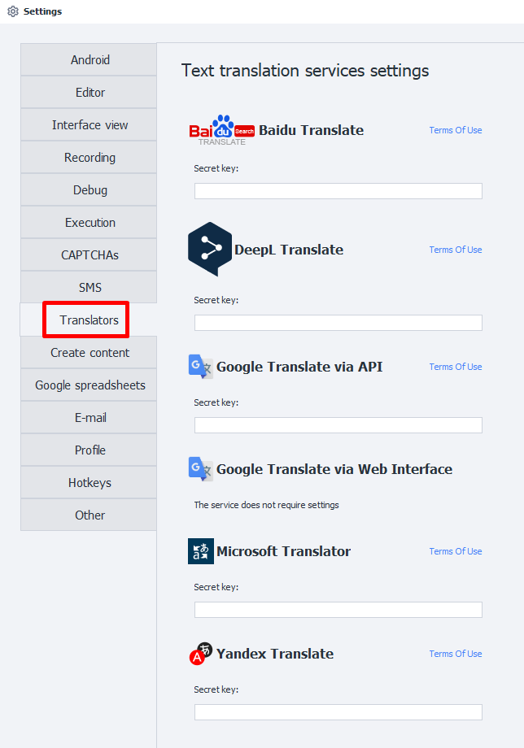
_______________________________________________
## Baidu Translate.
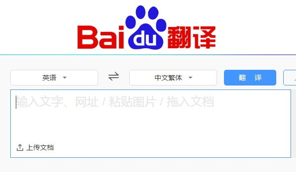  

:::info **The service’s native language is Chinese.**  
For easier setup, we recommend using a browser with a built-in translator.
:::

### Getting a secret key.  
#### 1. Go to the [service website](https://fanyi.baidu.com/).  
#### 2. Hover over the indicated character:  
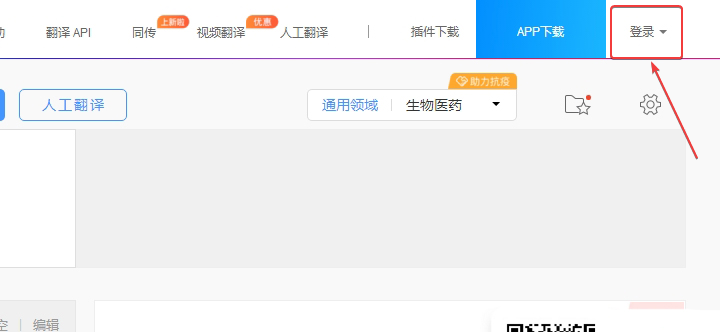  
#### 3. A pop-up window for signing in will appear:  
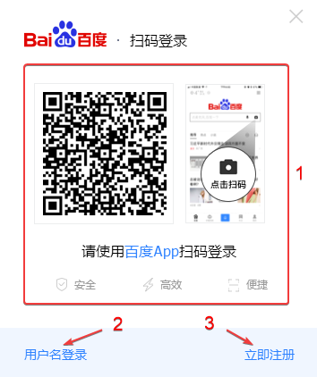  
#### 4. Sign in to the service.
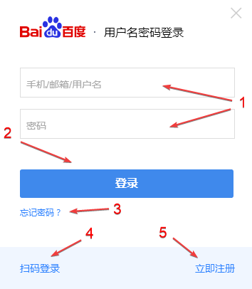  

**1**. Enter your username and password here.  
**2**. Sign-in button.  
**3**. Password recovery.  
**4**. Return to signing in through the app.  
**5**. Create an account.  

#### 5. Create a new account.  
In the sign-in window, select **Register**:  

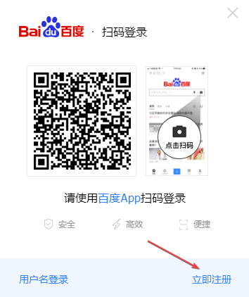  

A page will open where you can enter your details to create a new account:  

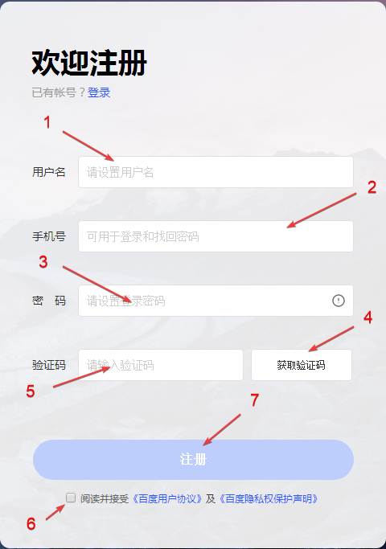  

**1**. Username.    
**2**. Phone number without the country code.  
:::info **Only Chinese phone numbers are accepted.**  
:::   
**3**. Password that meets the service requirements.    
**4**. Button to send a verification SMS.    
**5**. Field for entering the code from the SMS.  
**6**. Agree to the website’s terms of use.  
**7**. Register.    

After registering, you can copy the key from your account and paste it into **ZennoPoster settings**.  
_______________________________________________
## Deepl Translate.  
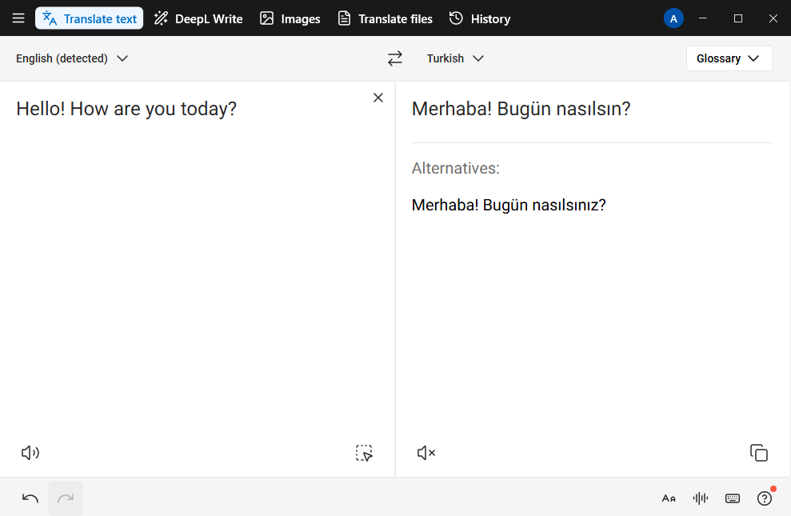

:::info **The service is temporarily unavailable to individuals and companies from Russia.**  
However, if you have a valid payment method from one of these countries or regions — the EU, Switzerland, the UK, the US, Canada, or Japan — you can access DeepL Pro by entering those details when paying.  
:::  

### Getting a secret key.  
#### 1. Go to the [service website](https://www.deepl.com/ru/translator) and click the button with three horizontal lines in the upper-right corner.  
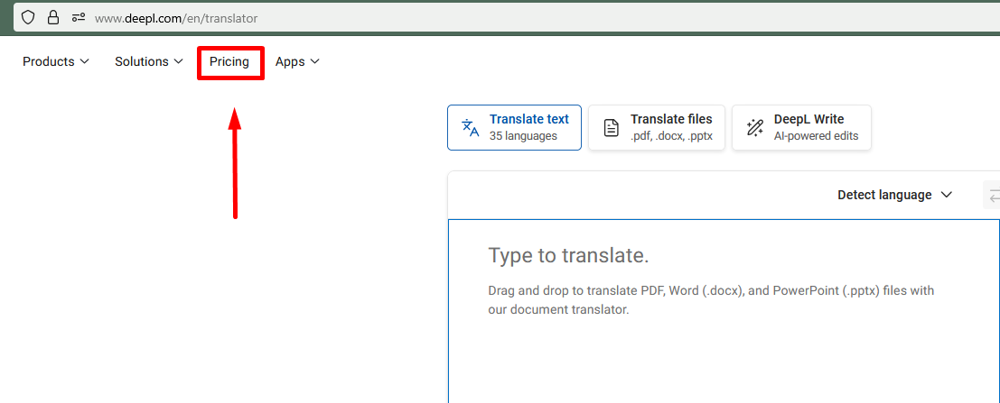  
#### 2. Click the **Plans** tab.  
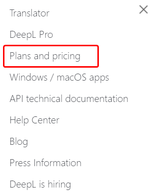  
#### 3. Select **DeepL API**, then choose one of the two plans: DeepL API Free *(free)* or DeepL API Pro *(€4.99)*.  
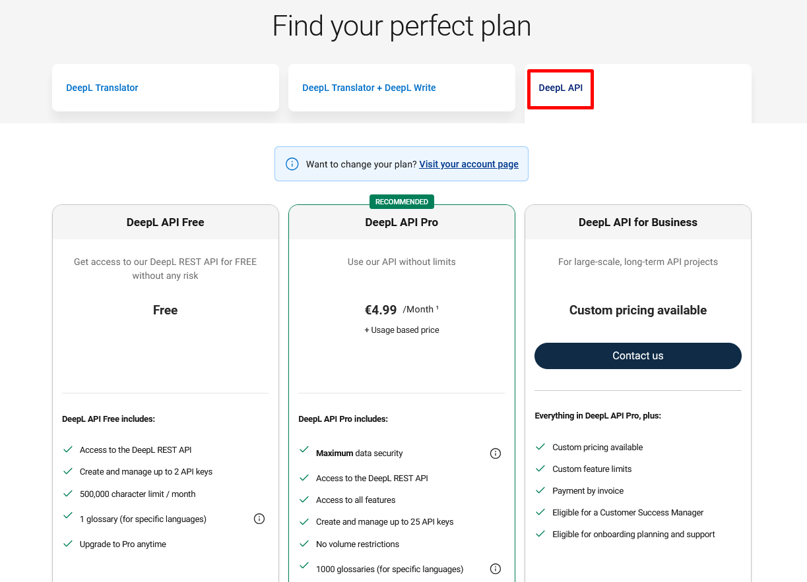  
#### 4. Now enter your **email** and create a **password**.  
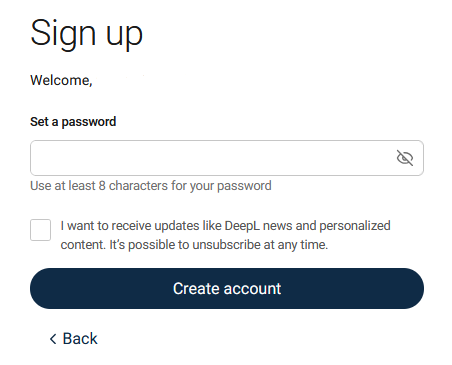  
#### 5. Next, fill in your personal details *(country, address, first and last name)*.  
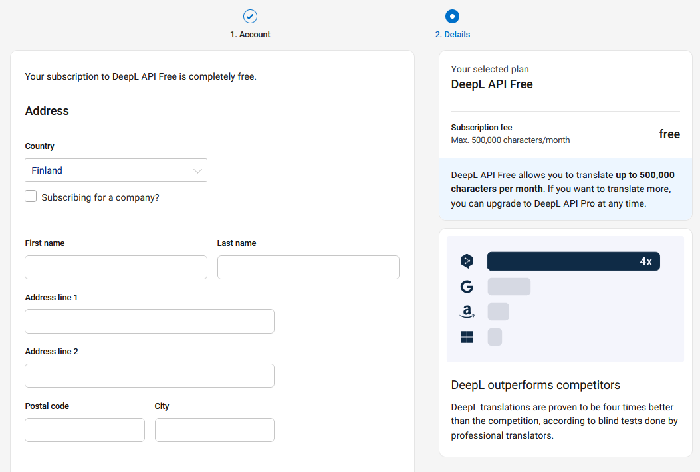  
#### 6. Then enter your card details.   
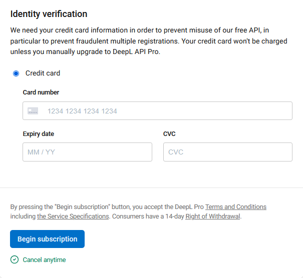  

Even if you choose the free plan, your card must still be valid for registration to succeed.  
#### 7. Once registration is complete, go to Account → API Keys.  
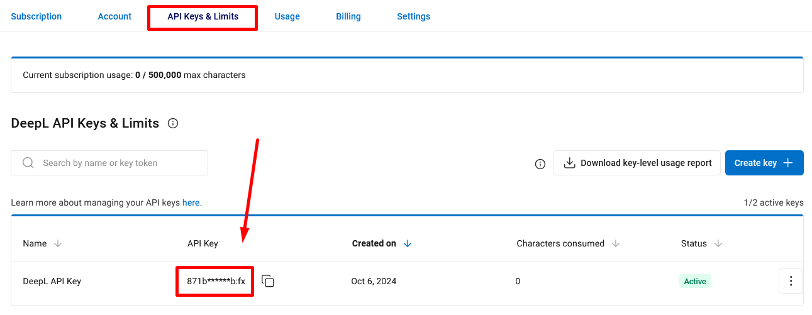  

Paste the API key you received into the ZennoPoster settings  
_______________________________________________
## Google Translate via API  
:::info **The service is temporarily unavailable to individuals and companies from Russia.**  
::: 

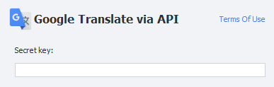  

:::tip **Before using the service, we recommend carefully reviewing its rates and prices.**  
::: 

### Getting a secret key. 
#### 1. First, sign in to your Google account.  
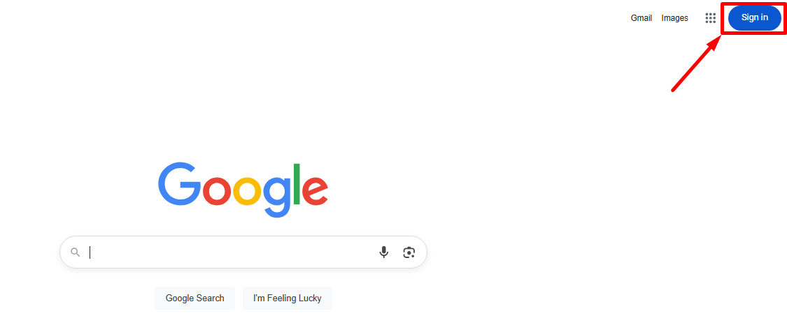   
#### 2. Then create your first project on the [**Google Cloud**](https://console.cloud.google.com/projectcreate) platform.  
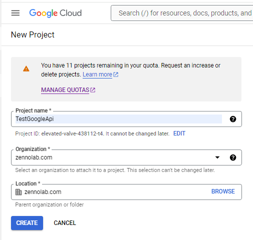  
#### 3. Now select your project and add [**Cloud Translation API**](https://console.cloud.google.com/apis/library/translate.googleapis.com?inv=1&invt=AbeTEA&project=sonic-verbena-438109-p0).  
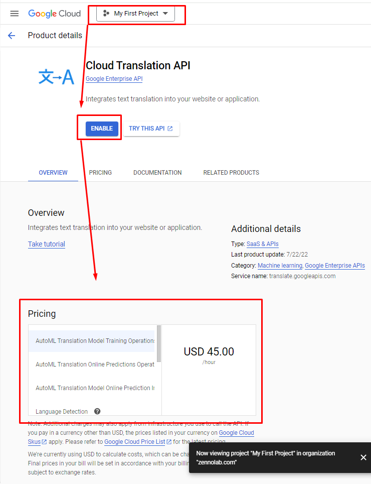 

:::info **You need to create a billing account with the service first.**  
:::  

#### 4. Get an API key and paste it into the ZennoPoster settings.  
_______________________________________________
## Google Translate in the Web Interface.  
No setup is required for this method; simply use [**Google Translate online**](https://translate.google.com/) in your browser.  

:::tip **Works for free.**  
:::
_______________________________________________
## Microsoft Translation. 
:::info **The service is temporarily unavailable to individuals and companies from Russia.**  
::: 

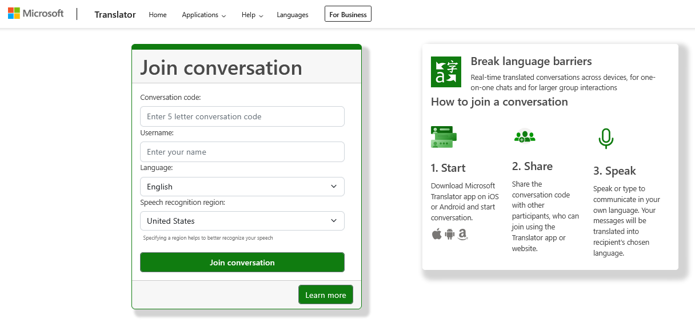  

:::tip **Before using the service, we recommend carefully reviewing its rates and prices.**  
:::  

### Getting an API key.
#### 1. Go to the [**Microsoft Azure**](https://azure.microsoft.com/en-gb/pricing/purchase-options/azure-account/) website and sign in, or create a new account.    
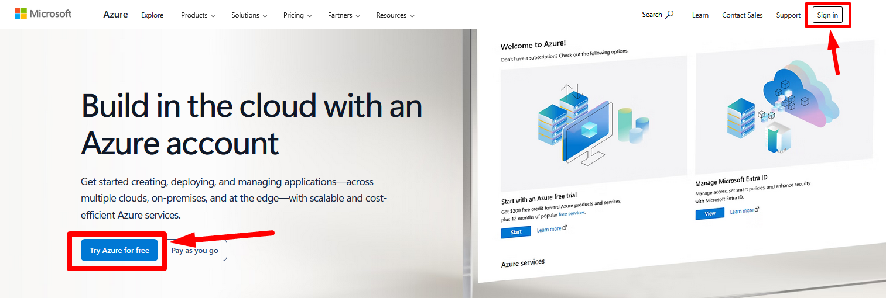  

:::tip **A 30-day trial is available.**  
:::

#### 2. After starting your trial, go to the [Azure services](https://portal.azure.com/) page and **create your resource**.  
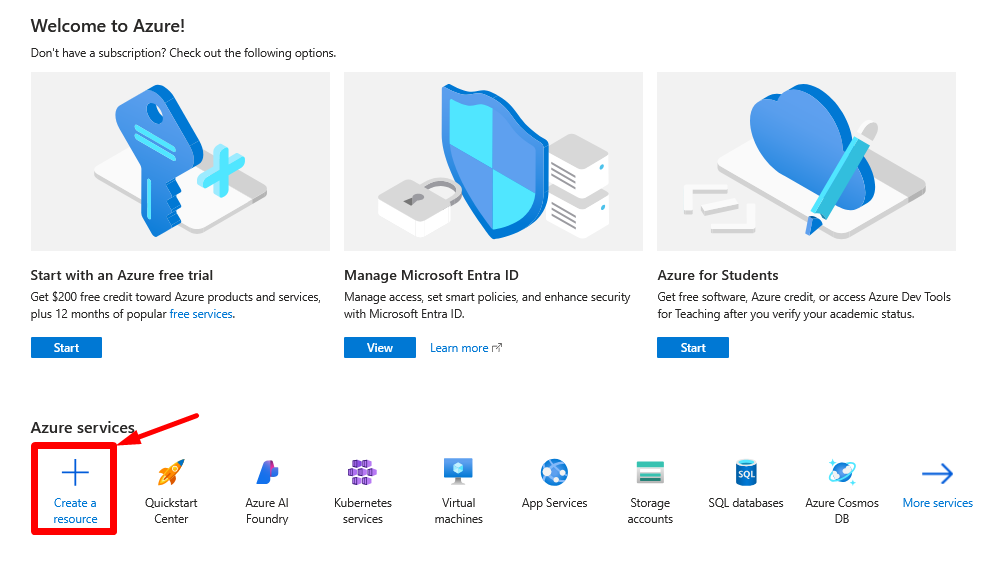  

#### 3. Find Translator using the search bar, open it, and click Create.  
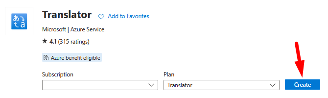  

#### 4. Get an API key and paste it into ZennoPoster.  
_______________________________________________
## Yandex Translate.  
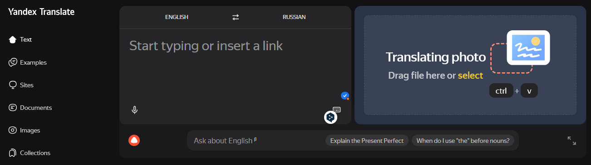

### Getting a secret key.  
#### 1. Sign up on the [**Yandex Cloud**](https://yandex.cloud/ru/services/translate) platform.  
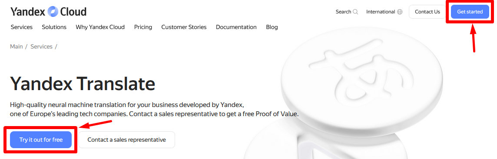  

:::tip **You’ll receive a starting grant to explore the platform.**  
:::

#### 2. After signing in, go to your [**personal dashboard**](https://console.yandex.cloud/folders/) and create a billing account.  
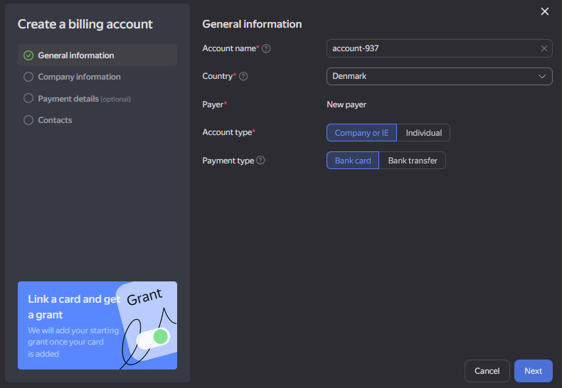  

#### 3. Now create a [**service account**](https://yandex.cloud/ru/docs/iam/concepts/users/service-accounts).
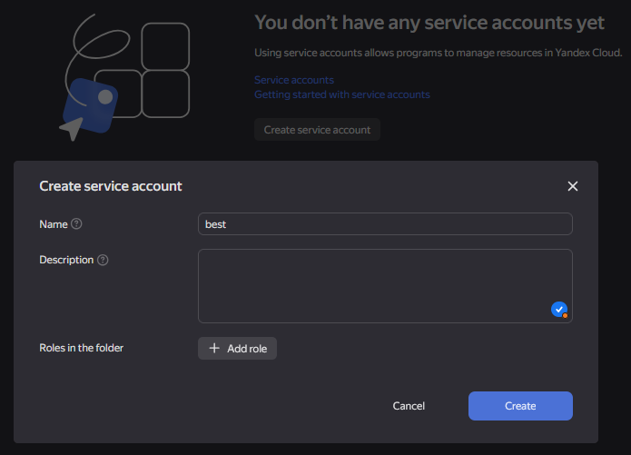  

#### 4. Next, go to the Access rights section in your [**personal dashboard**](https://console.yandex.cloud/folders/).  
Next to the account you need, click **the three-dot icon → Edit roles → Add role → `ai.translate.user`**.  

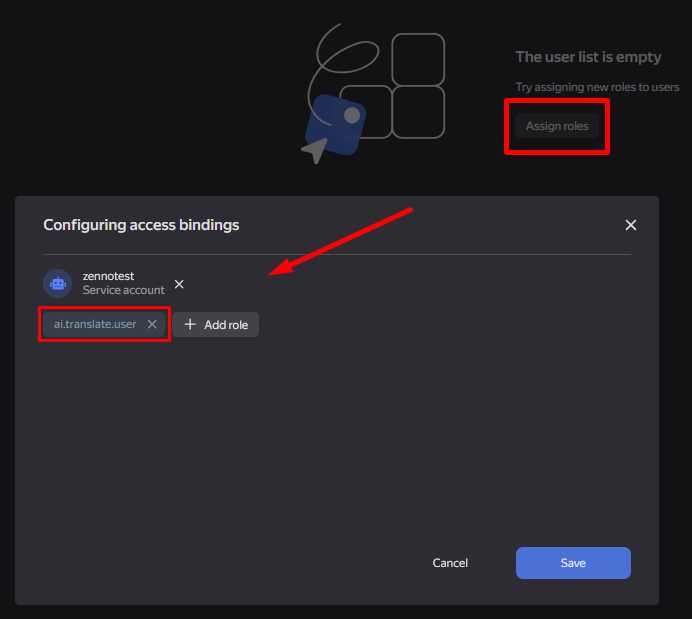  

#### 5. Go to the service account and create an API key.  
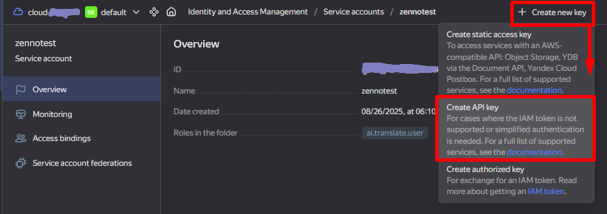  

:::warning **You can only view the key once — immediately after creating it**  
:::  
_______________________________________________
## Example.  
While a project is running, you can translate any content used in it. For example, translate a phrase from Russian into English to send it in a message.  

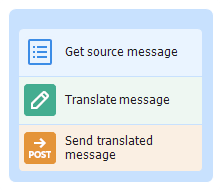  

1. Get a text string from a [**List**](../Project-editor/Actions-in-ProjectMaker-Actions-Blocks/Lists/List_Operations).  
2. Add the [**Text Processing**](../Project-editor/Actions-in-ProjectMaker-Actions-Blocks/Data/Text_Processing) action.  
3. Configure the translation function by specifying the desired service and parameters.  
4. Send the translated message to the recipient.  
