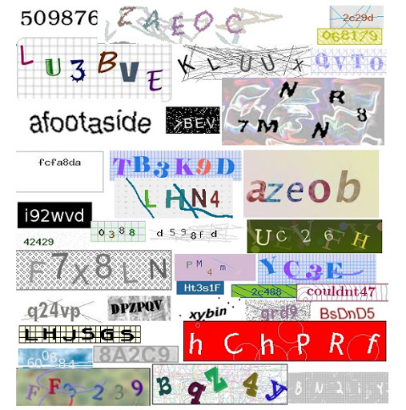
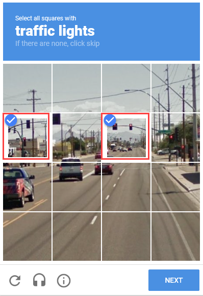
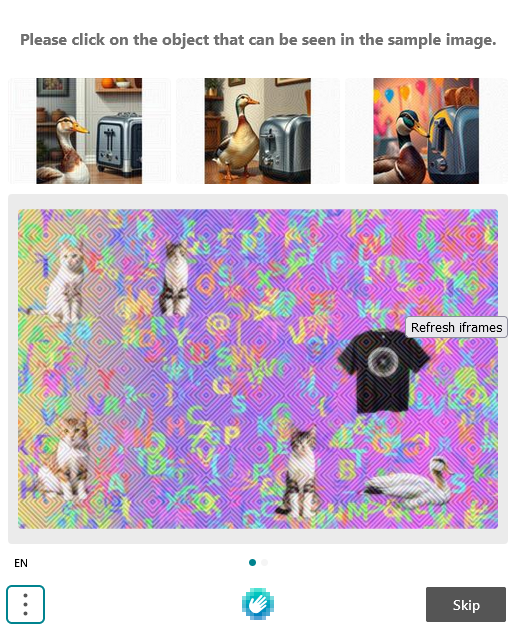
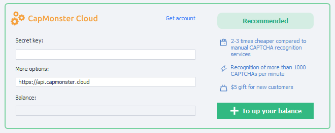
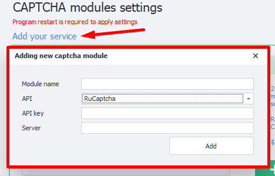

---
sidebar_position: 4
title: "CAPTCHAs"
description: ""
date: "2025-09-10"
converted: true
originalFile: "Капчи.txt"
targetUrl: "https://zennolab.atlassian.net/wiki/spaces/RU/pages/808845385"
---
import DisclaimerNotice from '@site/src/components/DisclaimerNotice';

<DisclaimerNotice />

> 🔗 **[Original page](https://zennolab.atlassian.net/wiki/spaces/RU/pages/808845385)** — Source of this material

_______________________________________________  
## Description
A **CAPTCHA** is an automatically generated test used to check whether a user is a human or a computer (bot). Simple CAPTCHAs often consist of distorted text made up of letters and/or numbers. They can use various color combinations, with noise, distortions, overlapping lines, or random shapes.  

|     | 
| :--------: | 
| **Examples of text CAPTCHAs.**  |  

There are also other types of CAPTCHAs where you don’t just enter characters from an image, but perform some kind of action. For example, you may be asked to find buses, palm trees, motorcycles, and other objects; solve a puzzle; arrange objects in a certain order; or sort them.  

#### More CAPTCHA examples:  

|     |  |
| :--------: | :-------: |
| [**ReCaptcha**](https://developers.google.com/recaptcha)  | [**HCaptcha**](https://www.hcaptcha.com/)    |  

|     |  |
| :--------: | :-------: |
| [**FunCaptcha**](https://www.arkoselabs.com/arkose-matchkey/)  | [**CloudFlare**](https://www.cloudflare.com/)    |
_______________________________________________
## What are these settings for?
ZennoPoster lets you solve text CAPTCHAs manually. To do this, simply select the `MonkeyEnter.dll` module in the [**Recognize CAPTCHA**](/zennoposter/ProjectMaker/Project-editor/Actions-in-ProjectMaker-Actions-Blocks/Tabs/Captcha_Recognition) action. But this can become a time-consuming task when you’re dealing with hundreds or even thousands of CAPTCHAs!  

And what if, for example, your project runs around the clock and a CAPTCHA can appear at any time?

That’s where the services listed here can help. **They’re designed to eliminate the need to enter CAPTCHAs manually**.  

  
_______________________________________________
## How do I connect a service?  
  
### Secret key  
Most services require what’s called an **API key**. This is a *unique string of random characters* that lets the service identify you. For example, it might look like this: `8fc9b30e544885b8480fb590dfcbdd71`.  

To get an API key, go to the website of the service you want to use and review its terms. Once you’ve made your choice, register with the CAPTCHA service and get your *API key* from your account.  

### Username and password  
Some services use the username and password you set when registering instead of an API key for authentication.  

### Additional parameters
Enter the **URL (domain)** used to receive API requests here. It’s set by default in the program and **shouldn’t be changed unless necessary**. If the URL isn’t already specified, check the documentation for the service you chose.  

### Balance  
Once you’ve authenticated with the service, your current balance will appear in this field.  

This field is also used to display error information (but not for all services).  
Possible errors: `IP_BANNED`, `ERROR_WRONG_USER_KEY`, etc. 

:::warning **If this field remains empty after you enter the API key**
An error has occurred.  

Possible causes include an incorrect key (or username/password), problems with the service, or a banned key.
:::
_______________________________________________
## Available services  
- [**CapMonster Cloud**](https://capmonster.cloud/) — Recommended 👍;    
- [2captcha](https://2captcha.com/);  
- [Anti-Captcha](https://anti-captcha.com/);  
- [BypassCaptcha](http://bypasscaptcha.com/);  
- [CheapCaptcha](https://cheapcaptcha.com/);  
- [DeathByCaptcha](https://deathbycaptcha.com/);  
- [DeCaptcher](http://decaptcher.com/);  
- [Imagetyperz](http://imagetyperz.com/);  
- [Jsdati](https://www.jsdati.com/);  
- [RuCaptcha](https://rucaptcha.com/);  
- [CapMonster 2 Desktop](https://zennolab.com/ru/products/capmonster/);  
_______________________________________________
## Custom module
### Adding a new module (service)  
You can also add your own CAPTCHA recognition service based on the APIs of popular services.  

  
### Required parameters 
:::tip **Not sure what information to enter?**
Please contact your service provider.
:::
#### Module name  
Enter a name for the module, **up to 20 characters**.  

#### API  
Select the API of the service you’ll use to create your module.  

#### API-key
The service key. Use the same key you enter in the **Secret key** field when connecting to the service.  

#### Server  
The URL (domain) where CAPTCHA-solving requests will be sent.  

### Sending CAPTCHAs to your module
After adding the module, you’ll be able to select it in the [**Recognize CAPTCHA**](/zennoposter/ProjectMaker/Project-editor/Actions-in-ProjectMaker-Actions-Blocks/Tabs/Captcha_Recognition) action.  

  

### Removing a module  
To remove a module you created from the program, **you need to delete two files**:  
- `c:\Users\USERNAME\AppData\Roaming\ZennoLab\Configs\ИмяМодуля.dll.config`  
- `c:\Users\USERNAME\AppData\Roaming\ZennoLab\CustomModules\Captcha\ИмяМодуля.dll`  

:::warning **We recommend closing ZennoPoster and ProjectMaker before deleting these files**
:::
_______________________________________________ 

## Useful links

- [❗→ Recognize CAPTCHA](https://zennolab.atlassian.net/wiki/spaces/RU/pages/534053026 "https://zennolab.atlassian.net/wiki/spaces/RU/pages/534053026")
- [❗→ Recognize Recaptcha](https://zennolab.atlassian.net/wiki/spaces/RU/pages/534053033/ReCaptcha "https://zennolab.atlassian.net/wiki/spaces/RU/pages/534053033/ReCaptcha")
- [Page for testing different types of CAPTCHAs](https://lessons.zennolab.com/captchas/ "https://lessons.zennolab.com/captchas/")
