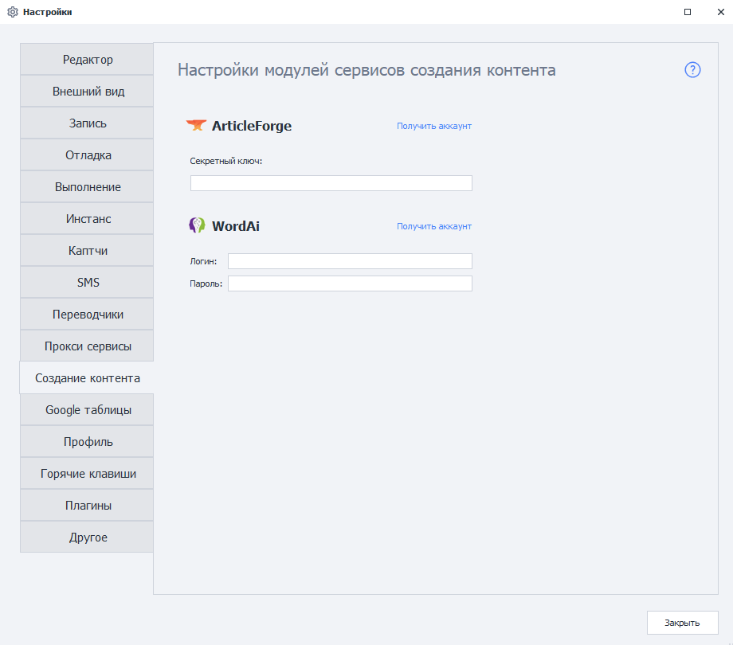
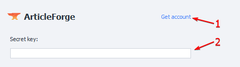
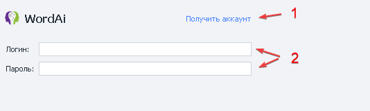

import DisclaimerNotice from '@site/src/components/DisclaimerNotice';

<DisclaimerNotice />

> 🔗 **[Original page](https://zennolab.atlassian.net/wiki/spaces/RU/pages/808812655)** — Source of this material

_______________________________________________  
## Description.  
These modules let you create content based on provided text using third-party services. AI-based technologies write text that is comparable in quality to human-written text.  

They are suitable for **rewriting text** and **creating unique content**.

:::warning **English only.**
:::  

### Appearance.  
  
_______________________________________________
### ArticleForge setup.  
  

#### 1. Create an account if you don't already have one.  
#### 2. Get your key from the API Information section.  
_______________________________________________
### WordAi setup.  
  

#### 1. Create an account if you don't already have one.  
#### 2. Enter your username and key from the API section in the ZennoPoster settings.  
_______________________________________________  

## Useful links

1. [❗→ Content creation](https://zennolab.atlassian.net/wiki/spaces/RU/pages/489095179 "https://zennolab.atlassian.net/wiki/spaces/RU/pages/489095179")
2. [❗→ Home page](https://zennolab.atlassian.net/wiki/spaces/RU/pages/735608964 "https://zennolab.atlassian.net/wiki/spaces/RU/pages/735608964")

