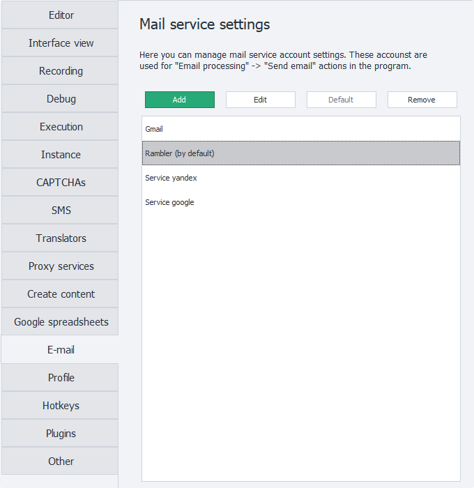
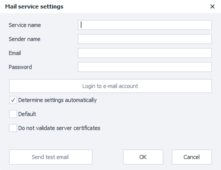
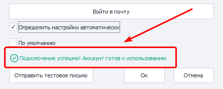
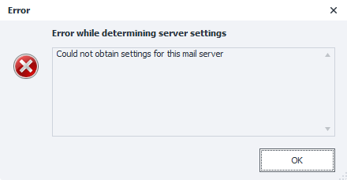

---
sidebar_position: 13
title: "Mail"
description: ""
date: "2025-09-10"
converted: true
originalFile: "Почта.txt"
targetUrl: "https://zennolab.atlassian.net/wiki/spaces/RU/pages/2084601865"
---
import DisclaimerNotice from '@site/src/components/DisclaimerNotice';

<DisclaimerNotice />

> 🔗 **[Original page](https://zennolab.atlassian.net/wiki/spaces/RU/pages/2084601865)** — Source of this material

_______________________________________________  
## Description  
This settings section is for connecting mailboxes that you can then use to [**send emails**](/zennoposter/ProjectMaker/Project-editor/Actions-in-ProjectMaker-Actions-Blocks/Mail/PM_Editor_Actions_SendMail).  

_______________________________________________  
## “Add” button  
Clicking this button opens a window where you can add a new connection. 

### Service name
A custom name for this account that you choose yourself. It will appear under this name in the list of available accounts, for example, in the [**Send mail**](/zennoposter/ProjectMaker/Project-editor/Actions-in-ProjectMaker-Actions-Blocks/Mail/PM_Editor_Actions_SendMail) action.  

:::warning **This is a required parameter and must be unique within the program**
:::  

### Sender name
The sender will appear under this name in a dedicated field for the recipient.

### Email
The full email address that will be used to send mail.  

:::info **It must be a real address, or the program will return an error**
:::  

### Password
The password for this mailbox.

For security reasons, some email providers require a special password for connecting third-party programs. This is called an **App password**. You can get one in the settings of the selected service.  

### “Log in to email” button
Clicking this button checks whether the details for connecting to the SMTP server are correct. 

> *The Email and password combination is not checked.*

If the connection is successful, a green message will appear at the bottom of the window:

If the program cannot connect to the server, an error pop-up will appear:

In this case, you need to configure the connection manually. To do this, clear the **Detect settings automatically** checkbox.  

### Detect settings automatically  
When this setting is enabled, the program will try to automatically determine the settings for connecting to the SMTP server based on the email address you entered.

If you get an error after the settings are detected automatically, clear the checkbox and enter them manually, using the information on the provider’s website as a guide.  

### Default
When this option is enabled, the current connection will be used by default in all [Send mail](/zennoposter/ProjectMaker/Project-editor/Actions-in-ProjectMaker-Actions-Blocks/Mail/PM_Editor_Actions_SendMail) blocks, unless specified otherwise.  

### Do not check server certificates
In some cases, you may get this error when connecting an account:  
**`An error occured while attempting to establish an SSL or TLS connection`**.  

This error most often occurs when establishing an unsecure connection to the mail server. As a result, the provider refuses the connection because the system cannot verify the authenticity of the SSL/TLS certificates.  

There can be various causes; here are the most common ones:  
- An old version of Windows with outdated trusted certificates;  
- Antivirus software that replaces server certificates to decrypt and inspect incoming traffic;  
- An enabled firewall.  

The solution depends on the specific cause. You can update Windows or disable the firewall. If the issue is caused by antivirus software, pay particular attention to its settings for inspecting incoming traffic and email.  

If nothing helps, enable this setting. After that, any certificates sent by the server to establish the connection will not be checked, and the connection will be marked as secure.  

:::warning **If you disable certificate checks, your traffic with the email provider may be intercepted.**
::: 

### “Send a test email” button
When you click it, ZennoPoster will try to send an email to your email address using the specified SMTP server. This is used to check whether the entered details work.  

If the account credentials are correct, the status **`Test email sent successfully`** will be displayed. This means the mail service is ready to use in the program.  

If you enter incorrect information, the error **`Failed to send test email`** will be displayed. You can see a more detailed description in the window.  

:::tip **Some email providers require you to explicitly enable mail access for third-party programs**
You can find the appropriate settings by searching for:  
`smtp настройки подключения <НАЗВАНИЕ_ВАШЕГО_ПРОВЙДЕРА>`
:::  
_______________________________________________  
## Additional buttons
### “Edit”
Use this button to edit mail accounts you have already added

### “Default”
This option lets you change which account is used by default

### “Delete”
Deletes the selected account from the program settings.

* * *

## Useful links

- [❗→ Send mail](https://zennolab.atlassian.net/wiki/spaces/RU/pages/1399914500 "https://zennolab.atlassian.net/wiki/spaces/RU/pages/1399914500")
- [❗→ Mail service connection settings](https://zennolab.atlassian.net/wiki/spaces/RU/pages/2084569120 "https://zennolab.atlassian.net/wiki/spaces/RU/pages/2084569120")
- [❗→ Receive mail](https://zennolab.atlassian.net/wiki/spaces/RU/pages/735576144 "https://zennolab.atlassian.net/wiki/spaces/RU/pages/735576144")

