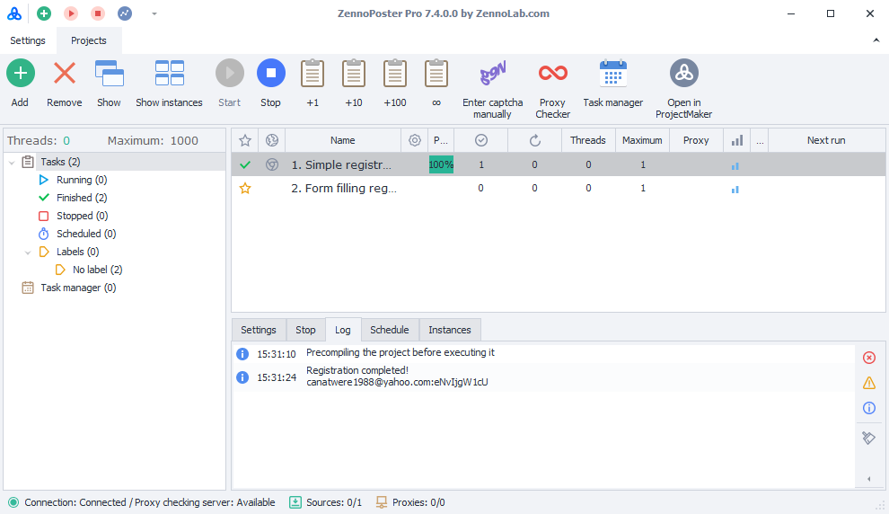
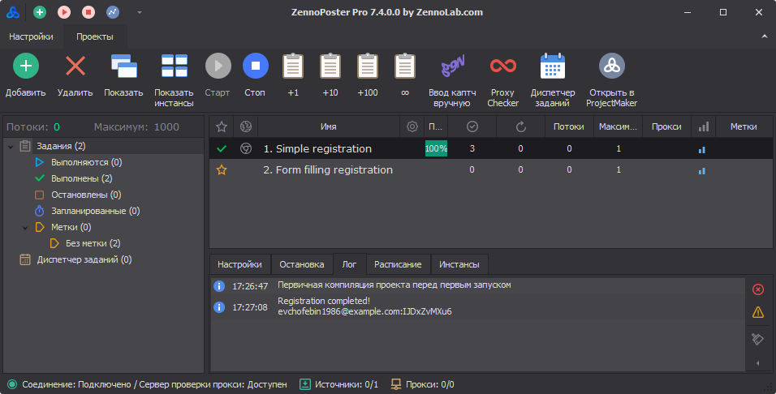
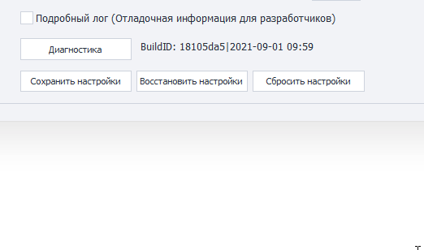

---
sidebar_position: 12
title: "Other ZennoPoster Settings"
description: ""
date: "2025-09-10"
converted: true
originalFile: "Другие настройки ZennoPoster.txt"
targetUrl: "https://zennolab.atlassian.net/wiki/spaces/RU/pages/808779861/ZennoPoster"
---
import DisclaimerNotice from '@site/src/components/DisclaimerNotice';

<DisclaimerNotice />

> 🔗 **[Original page](https://zennolab.atlassian.net/wiki/spaces/RU/pages/808779861/ZennoPoster)** — Source of this material

_______________________________________________  

## General settings
### Disable program error reports (globally)
Sometimes, a browser error causes an instance to crash. ZennoPoster detects the crash and automatically restarts the instance. However, the error message window may prevent the restart.

Enable this setting to prevent these windows from appearing.
### Disable the dialog for restoring project settings
After a crash, ZennoPoster may offer to restore project settings. This option disables the recovery window.

:::info We recommend leaving the recovery window enabled
Disable it only if it prevents ZennoPoster from starting automatically
:::

### Skip scheduled task execution for running tasks
If a project is still running when its scheduled start time arrives, the scheduler will wait for the current run to finish and only then start the task.  

### Minimize ZennoPoster to the system tray
When you minimize the program window, it will be sent to the system tray.  

:::tip **What is the system tray?**
***The system tray** is an area of the Windows taskbar that opens when you click the arrow on the right side of the taskbar. It's used for programs that run for a long time but aren't used constantly.* 
::: 

### Track thread status
Enables collecting statistics about thread status. This information helps [support](https://helpdesk.zennolab.com/ru/conversation/new) troubleshoot the program.

> **Enable this setting only when asked to do so by support.**  

### Compact the large object heap
Sets the compaction interval for the large object heap — the area of memory where large objects, such as long strings, are stored.  

### Automatically resume active tasks after a restart
After restarting, ZennoPoster will automatically resume tasks that were active before the program was closed.
_______________________________________________ 
## Theme
### Light

### Dark

_______________________________________________ 
## Configure the project download directory
Projects you receive from other users will be saved in this folder. The folders will be named using the project developers' email addresses or their ZennoLab IDs.  

:::warning Do not copy projects into this folder manually!
:::

_______________________________________________ 
## Log settings
A log is an event journal where ZennoPoster saves messages about project activity.  

### Disable automatic log scrolling only when clicking a log entry
When new entries appear, the log automatically scrolls down.  

If this setting is enabled, you can stop automatic scrolling only by clicking an entry.

### Show notifications only in the log
Messages from the “[Notification](/zennoposter/ProjectMaker/Project-editor/Actions-in-ProjectMaker-Actions-Blocks/Logic/Notification_Log_Entry)” action will appear only in the log, without pop-up windows.  

> *This setting works independently of the action's own settings.*  

### Show the date in the log
Adds the date to log entries.

### Show notifications in the log when a project completes successfully
Adds an entry to the log when a project completes successfully.

### Show notifications in the log when a project fails
Adds an entry to the log when a project fails.

### Keep log entries for this many hours
Sets the maximum time, in hours, that log entries are kept.

### Maximum number of entries per task
Sets the maximum number of entries kept in the log for a single task.

:::info Maximum value: `9999`
:::

### Maximum log entry size
Limits the maximum size, in kilobytes, of an entry that can be *displayed* in the **Log window**. 

### Limit the maximum size of entries in the log file
:::tip **We recommend enabling this**
*Users working with large data sets who don't need the full log are **recommended to enable this limit**. This will improve performance and reduce memory usage.*  
:::   
This setting limits the size of an entry that can be *saved* to the log file.  
:::info **Logs**
Log files are stored in the **Logs** folder in the directory where ZennoDroid is installed.  
Example path: `C:\Program Files\ZennoLab\RU\ZennoDroid Pro\2.3.8.0\Progs\Logs\`  
:::   

:::warning **You must restart the program for changes to take effect**
:::  
  
_______________________________________________ 
## Miscellaneous
### Detailed log (debugging information for developers)

Records detailed information about the program's operation that may be needed when contacting **Support**.

### BuildID  
The combination of letters and numbers in this field shows the current program version and release date.  
:::tip **You can select and copy the value in this field using the context menu**
:::  

### Available buttons  
#### Diagnostics  
Opens the `diagnostic.exe` utility, which displays information when problems occur. After it runs, a `report.zip` file will be created in the ZennoDroid installation directory.  

#### Save settings  
Saves the program's current settings. To use this option, click the button first, then close the program.  

#### Restore settings  
Restores the most recently saved settings. Again, click this button first, then restart the program.  

#### Reset settings  
Resets the current settings to their default values.  

