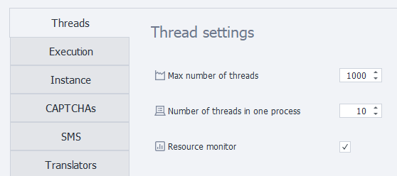

---
sidebar_position: 1
title: "Thread Settings"
description: ""
date: "2025-09-10"
converted: true
originalFile: "Настройка потоков постера.txt"
targetUrl: "https://zennolab.atlassian.net/wiki/spaces/RU/pages/808812646"
---
import DisclaimerNotice from '@site/src/components/DisclaimerNotice';

<DisclaimerNotice />

> 🔗 **[Original page](https://zennolab.atlassian.net/wiki/spaces/RU/pages/808812646)** — Source of this material

_______________________________________________  

## Maximum number of threads
Sets the total number of threads that all running projects can use at the same time.

## Number of threads in one process
Determines how many threads run within a single process and share the computer's resources.  

Increasing this value can reduce resource consumption, but threads within a single process may run a little slower.

:::warning This setting only works when using the Firefox 45 engine
For all other browser types, only one thread per process is always launched, regardless of the specified value.
:::

## Monitor computer resources
When this setting is enabled, new threads will only start if enough computer resources are available.
