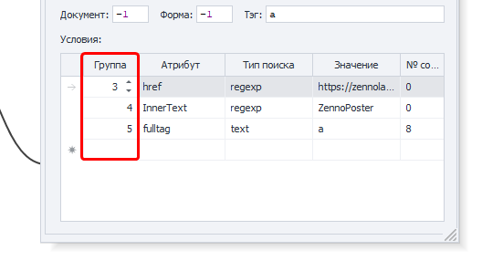

---
sidebar_position: 2
title: "Project Execution Settings"
description: ""
date: "2025-09-10"
converted: true
originalFile: "Настройки выполнения проектов.txt"
targetUrl: "https://zennolab.atlassian.net/wiki/spaces/RU/pages/809074766"
---
import DisclaimerNotice from '@site/src/components/DisclaimerNotice';

<DisclaimerNotice />

> 🔗 **[Original page](https://zennolab.atlassian.net/wiki/spaces/RU/pages/809074766)** — Source of this material

_______________________________________________  

### Clipboard buffer size between processes
Sets the buffer size for transferring data between processes. The allowed value is from **10** to **1000** MB.  

The default value is **10** MB. You don't need to change it unless you're troubleshooting a specific problem and have been advised to do so.

:::warning This setting does not limit the maximum size of lists or tables
used in a project.
:::

### FTP operation timeout (sec)
Sets how long the program waits for an FTP operation to complete, in seconds.

### Number of HTTP request attempts
Sets the number of attempts to make an [HTTP request](/zennoposter/ProjectMaker/Project-editor/Actions-in-ProjectMaker-Actions-Blocks/Http/HTTP-request).  

### Use alternative method for sending HTTP requests
> Set globally for the program and applied to all new projects.  

Enables the alternative method of executing HTTP requests by default.

:::info Two methods for executing HTTP requests:
- standard — uses the third-party Chilkat library;
- alternative — ZennoLab's own implementation.
:::

If HTTP requests don't work correctly with the standard method, try switching to the alternative method.  

> *You can also change this in the settings for an individual project.*

### Use HTTP Connection Pool
Enables an optimized mechanism for handling HTTP connections, improving request execution stability.

### Maximum number of HTTP Connection Pool connections
Limits the number of connections that ZennoPoster and ProjectMaker can use simultaneously. This helps stabilize the program when executing a large number of HTTP requests.  

### Respect group order when using classic element search
When this setting is enabled, condition groups are processed in order, according to their numbers in the **Group** column.

### Save files safely
Helps prevent files and lists from being corrupted if the server suddenly becomes overloaded.

### Search for a project with the .zp extension when running the “Project in project” action
If the [Project in project](/zennoposter/ProjectMaker/Project-editor/Actions-in-ProjectMaker-Actions-Blocks/Project/Project_in_Project_Nested_Projects) action specifies a project in the old `.xmlz` format, but that file can't be found, the program will try to find a project with the same name and the `.zp` extension.

:::info Added in version 7.4.0.0
:::

### Keep an empty file in UTF8 encoding
Preserves UTF-8 encoding if the list associated with the file remains empty while the project is running.

### Run unfinished projects at startup
When the program starts, resumes projects that didn't finish before it was last closed.  

Projects will only be restarted if you selected the corresponding option when closing the program.

### Higher-priority threads interrupt requests from lower-priority threads
Takes thread priority into account when processing requests while projects are running in multithreaded mode.  

Requests from higher-priority threads can interrupt requests from lower-priority threads.

### Validate entered data
:::warning Removed from the program starting with version 7.1.7.0
:::

In previous versions, this setting validated data entered in web element fields. If a field on a website was filled in twice, it was recommended that you disable this setting.

### Reset task failures when adding attempts
Resets the task's failed execution counter when new attempts are added.

### Detailed email activity log
Enables detailed logging of email operations.

### Detailed FTP activity log
Enables detailed logging of FTP operations.

### Detailed HTTP activity log
Enables detailed logging of HTTP request operations.

### File change handling policy
Determines how the program handles external changes to files associated with lists and tables:

#### Always load changes from the file while running
The program automatically loads changes made to the associated file while the project is running.

#### Never load external changes while running
The program loads the file's contents when the project starts, but ignores any subsequent external changes.

#### Ask the user
When external changes are detected, the program asks for confirmation before loading them.

### C# thread culture
Sets the regional settings used when running and debugging projects, including [C# blocks](/zennoposter/ProjectMaker/Project-editor/Actions-in-ProjectMaker-Actions-Blocks/Custom_code/CSharp_Code).

> **Restart required for changes to take effect**

The selected culture can affect how the following are handled:
- dates and times;
- numbers;
- decimal separators;
- other region-dependent formats.  

> The Russian version of the program uses the `ru-RU` culture by default.

:::info To use `InvariantCulture`  
Clear the input field completely and leave it empty.
:::