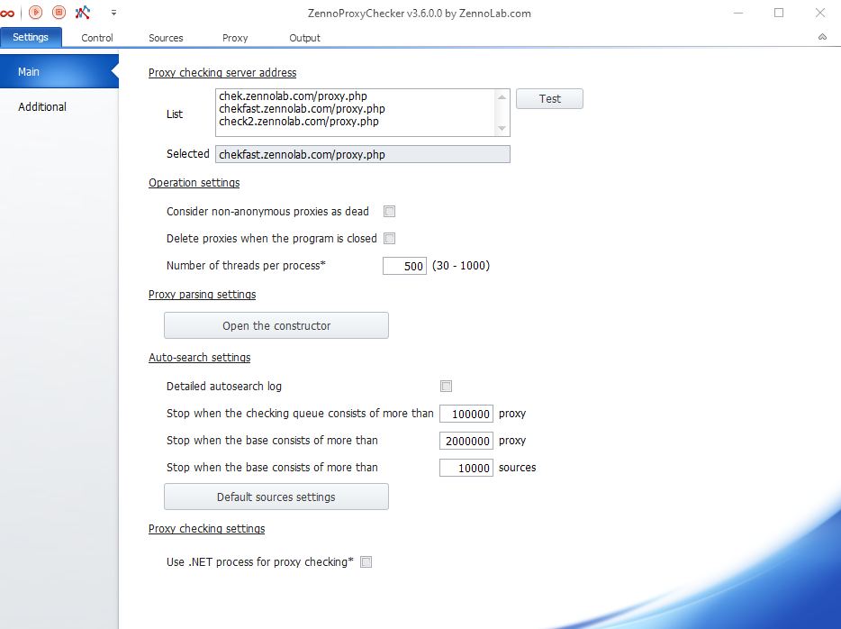
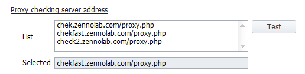
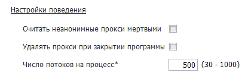
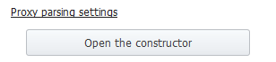
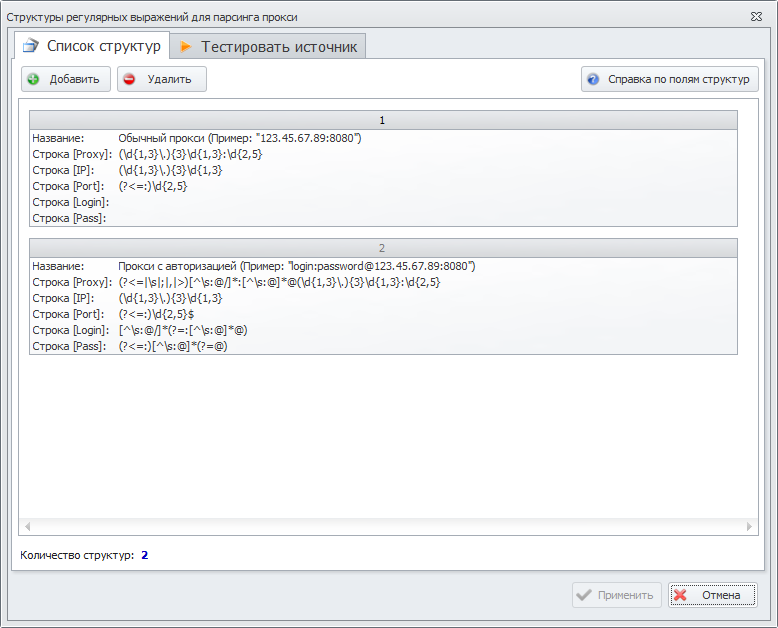
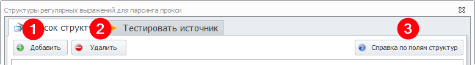
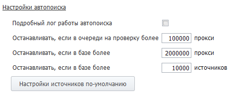
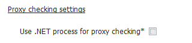

---
sidebar_position: 2
title: "ProxyChecker Settings"
description: ""
date: "2025-09-10"
converted: true
originalFile: "Настройки ProxyChecker.txt"
targetUrl: "https://zennolab.atlassian.net/wiki/spaces/RU/pages/848560318/ProxyChecker"
---
import DisclaimerNotice from '@site/src/components/DisclaimerNotice';

<DisclaimerNotice />

> 🔗 **[Original page](https://zennolab.atlassian.net/wiki/spaces/RU/pages/848560318/ProxyChecker)** — Source of this material

_______________________________________________  

_______________________________________________ 
## Proxy check server address
In this section, you can select the server the program will use to check whether proxies are working.  

### List
Contains the URLs of proxy check servers.  

By default, the list contains three addresses. You can add your own if needed.

### “Test” button
Checks the addresses in the list one by one.  

The check ends:
- when the program finds the first working server;
- when all addresses have been checked, if none of them are working.

### Selected
Displays the server address that will be used to check whether all proxies are working.

The first working address in the list is automatically entered in this field.
_______________________________________________ 
## Behavior settings

### Treat non-anonymous proxies as dead
Excludes non-anonymous proxies from the results. The program will treat them as nonworking and use only anonymous proxies.

### Delete proxies when closing the program
Clears the proxy list when the program closes.

### Threads per process
Sets the number of threads used by each process to check proxies.

:::warning Restart the program to apply changes
:::
_______________________________________________ 
## Proxy parsing settings
In this section, you can add new and edit existing proxy parsing structures. Each structure consists of a set of regular expressions.  

To configure structures, click **Open builder**.

### Proxy parsing structure builder

#### “Structure list” tab
By default, the list contains two structures with regular expressions.

On this tab, you can:
- create your own structure using the **Add (1)** button;
- delete an existing structure using the **Delete (2)** button;
- view descriptions of the available fields using the **Structure fields help (3)** button.  

The proxy format may vary from site to site. If needed, you can create a structure for almost any format and then test it on a specific source.

#### “Test source” tab
On this tab, you can test the parsing structure you created.  

**Source address** — enter the address of the website the program should get proxies from.

**Selected structure** — select a parsing structure previously added on the **Structure list** tab.

After filling in the fields, click **Test**. Proxies found using the selected structure will appear in the **Test results** window.

:::warning Parsing results are not saved
When you close the builder or click **Cancel**
:::
_______________________________________________ 
## Automatic search settings

### Detailed automatic search log
Enables detailed logging of ZennoProxyChecker when running in automatic search mode.

### Stop if more than XXX proxies are queued for checking
Stops automatic search when the number of proxies queued for checking exceeds the specified value.

### Stop if the database contains more than XXX proxies
Stops automatic search when the number of proxies in the database exceeds the specified value.

### Stop if the database contains more than XXX sources
Stops automatic search when the number of sources in the database exceeds the specified value.

### Default source settings
Sets the parameters that will be applied automatically to all new sources.  

For more information about the available parameters, see [Source settings](/zennoproxychecker/Program%20interface/Sources/Source_settings).  
_______________________________________________ 
## Proxy check settings

### Use .NET process to check proxies
Uses the `CheckingProcessor` implementation on the .NET platform to check proxies.
  
:::warning Restart the program to apply this setting
:::  
_______________________________________________ 
## Useful links

- [❗→ Working with proxies](https://zennolab.atlassian.net/wiki/spaces/RU/pages/534086266 "https://zennolab.atlassian.net/wiki/spaces/RU/pages/534086266")
- [❗→ Source settings](https://zennolab.atlassian.net/wiki/spaces/RU/pages/1892876309 "https://zennolab.atlassian.net/wiki/spaces/RU/pages/1892876309")
