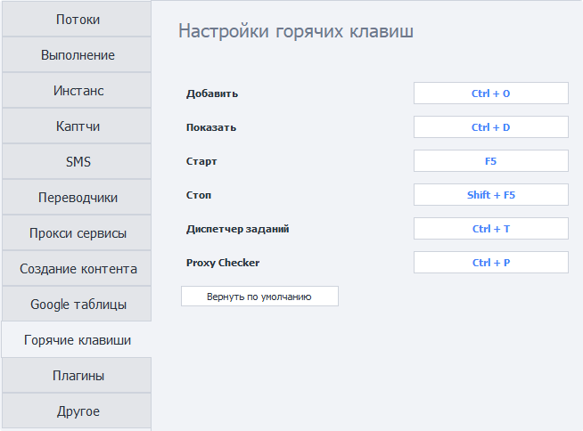

---
sidebar_position: 10
title: "ZennoPoster Hotkeys"
description: ""
date: "2025-09-10"
converted: true
originalFile: "Горячие клавиши ZennoPoster.txt"
targetUrl: "https://zennolab.atlassian.net/wiki/spaces/RU/pages/809107528/ZennoPoster"
---
import DisclaimerNotice from '@site/src/components/DisclaimerNotice';

<DisclaimerNotice />

> 🔗 **[Original page](https://zennolab.atlassian.net/wiki/spaces/RU/pages/809107528/ZennoPoster)** — Source of this material

_______________________________________________  
## Description
Here we'll cover the default keyboard shortcuts, which you can also change to any key combinations you like.  

 
- **Add — `Ctrl + O`**. Opens the window for adding a new project to the program.  
- **Show — `Ctrl + D`**. Switches to the **Instances** tab for the selected project. 
- **Start — `F5`**. Starts the selected project.  
- **Stop — `Shift + F5`**. Stops the selected project. 
- **Task Manager — `Ctrl + T`**. Opens the Task Manager window.  
- **Proxy Checker — `Ctrl + P`**. Opens the Proxy Checker management window.  
_______________________________________________
## Reassigning keys.  
To change a shortcut, simply click the field you want and press the desired key combination on your keyboard.  

  

To restore the original shortcuts, simply click **Restore defaults**.
_______________________________________________
